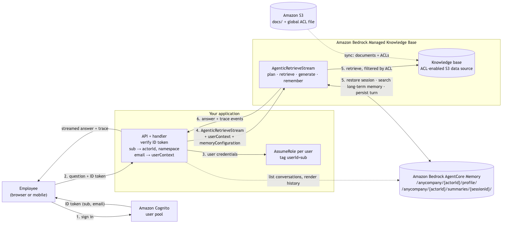
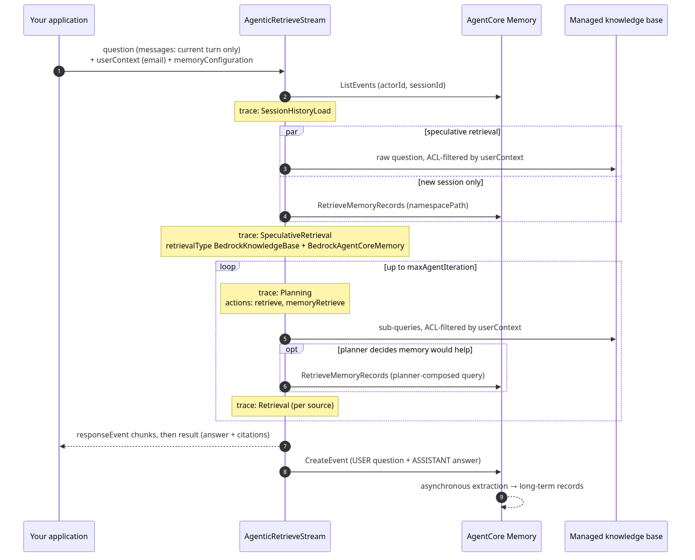

# Memory-aware AI agents with Agentic Retrieve on Amazon Bedrock Managed Knowledge Base

This sample shows how to build a memory-aware, multi-user assistant with Agentic Retrieve on Amazon Bedrock Managed Knowledge Base and Amazon Bedrock AgentCore Memory.

The sample is the companion code of the AWS blog post "Build memory-aware AI agents with Agentic Retrieve on Amazon Bedrock Managed Knowledge Base".

It is a small, complete application in which many authenticated users share one knowledge base and one **Amazon Bedrock AgentCore Memory** resource. Each user sees only the documents their ACL allows, and each user's memory stays private. Every turn is one `AgenticRetrieveStream` call with a `userContext` and a `memoryConfiguration`: the service filters documents by the user's email, restores the conversation, searches the user's long-term memory when it helps, streams a cited answer, and saves the turn back to memory. The application keeps no conversation store.

The running example is an internal employee assistant for AnyCompany, a fictional company. Employees sign in with Amazon Cognito and ask questions over HR policies, IT guides, engineering runbooks, and sales plans.

## Architecture



| Component | Purpose |
|-----------|---------|
| **Amazon S3** | Holds the synthetic corpus in `data/` under `docs/`, and a global ACL file (`acl/global-acl.json`) that says which email may read which folder. |
| **Amazon Bedrock Managed Knowledge Base** (×1) | Syncs the bucket through an ACL-enabled Amazon S3 data source, indexes each document with its ACL, and returns only the documents the `userContext.userId` may read. |
| **Amazon Bedrock AgentCore Memory** (×1, shared) | Holds every employee's conversations (short-term memory) and extracted facts and preferences (long-term memory), separated per user by `{actorId}` in the namespaces. |
| **Amazon Cognito** | Authenticates users. The ID token's `sub` is the memory `actorId`. Its verified, immutable `email` is the `userContext.userId`. |
| **IAM application role** | Assumed by the backend once per user with the session tag `userId=<sub>`. Its memory statements only allow that user's `actorId` and namespace ([`infra/app-role-policy.json`](infra/app-role-policy.json)). Its trust policy accepts only the backend's own principal and requires the tag ([`infra/app-role-trust-policy.json`](infra/app-role-trust-policy.json)). |
| **Backend** (`backend/`, FastAPI) | Local stand-in for API Gateway + Lambda. Verifies the ID token, derives identity, calls `AgenticRetrieveStream`, streams the answer and trace. |
| **Frontend** (`frontend/`) | Single-page UI: sign in, chat, see the trace and what memory knows about you. |

### How it works

1. The employee signs in with Cognito and receives an ID token.
2. The backend validates the token: signature, issuer, expiry, audience, `token_use: id`, and `email_verified`. Anything else is HTTP 401.
3. The backend derives every user-scoped value from two claims: `sub` gives the memory `actorId` and namespace, `email` gives `userContext.userId`. The client body carries only `{ question, sessionId?, persist?, useLongTermMemory? }`. Both booleans default to `true` and the UI never sends them; `scripts/e2e.py` turns them off so its access-control probes leave nothing in memory. Neither can name another user's data.
4. The backend assumes the application role for this user (session tag `userId=<sub>`, `SourceIdentity=<sub>`) and calls `AgenticRetrieveStream` with `userContext` and a `memoryConfiguration` bound to the user.
5. Managed Knowledge Base restores the session, plans, retrieves only the documents the user's ACL allows plus the user's long-term memory, streams a cited answer, and persists the question and answer. AgentCore Memory extracts long-term records asynchronously.
6. Trace events stream back with the answer. The backend logs them with a correlation ID and the UI shows how the answer was produced.



### How identity maps to the request

| Request field | Derived from | What it scopes | Enforced by |
|---|---|---|---|
| `userContext.userId` | ID token `email` (verified, immutable) | Which documents can be retrieved | Knowledge base ACL filtering |
| `memoryConfiguration.sessionBinding.actorId` | ID token `sub` | Whose short-term memory is restored and written | AgentCore Memory keying + IAM tag condition |
| `memoryConfiguration.sessionBinding.sessionId` | Server on a new conversation; client echoes it; listed with `ListSessions` | Which conversation within that actor | Keyed under `actorId` |
| `memoryConfiguration.retrievalConfigs[0].namespacePath` | `/anycompany/<sub>/` | Which long-term records may be searched | IAM tag condition |

`actorId` is the `sub`, not the email: the `sub` never changes and is never reused, while an email can be reassigned to a new employee, who would then inherit the old memory.

### Who can read what

`infra/setup.py` writes this as the data source's global ACL file:

| Folder | Documents | maya (engineer) | liam (engineer) | sofia (sales) |
|---|---|---|---|---|
| `hr/` | PTO, remote work, benefits, expenses, onboarding | ✓ | ✓ | ✓ |
| `it/` | VPN, laptop setup, access requests | ✓ | ✓ | ✓ |
| `engineering/` | deployment runbook, on-call guide | ✓ | ✓ | |
| `sales/` | commission plan | | | ✓ |

## Project structure

```
.
├── backend/
│   ├── app.py            # FastAPI: /api/chat (SSE), /api/conversations, /api/memory, serves the UI
│   ├── assistant.py      # Builds the AgenticRetrieveStream request; reads memory for the UI
│   ├── aws_sessions.py   # AssumeRole of the app role once per user (session tag userId=<sub>)
│   └── identity.py       # Verifies the Cognito ID token; Principal -> actorId, email, namespacePath
├── frontend/
│   ├── index.html        # Single-page UI (no build step)
│   └── static/           # app.js and app.css, served under a Content-Security-Policy
├── infra/
│   ├── setup.py          # Creates bucket, KB + ACL S3 data source, memory, Cognito, IAM; syncs (idempotent)
│   ├── teardown.py       # Deletes everything setup.py created
│   ├── app-role-policy.json         # The application role's policy (placeholder IDs)
│   └── app-role-trust-policy.json   # The application role's trust policy (placeholder IDs)
├── data/{hr,it,engineering,sales}   # Synthetic AnyCompany corpus (11 short Markdown documents)
├── scripts/
│   ├── serve.sh          # Start the backend
│   ├── turn.py           # One turn from the command line, as the backend would issue it
│   ├── wait_for_extraction.py   # Poll long-term memory until records appear for a user
│   ├── e2e.py            # 20 assertions against the running backend
│   ├── abac_probe.py     # Check that IAM denies malformed role sessions and mis-scoped memory calls
│   └── screenshots.py    # Browser run + screenshots (needs playwright)
├── tests/                # Unit tests: token verification and the IAM policy documents
├── docs/                 # Diagrams (Mermaid sources in docs/diagrams/), screenshots, observed behavior
├── requirements.txt      # Runtime dependencies
├── requirements-dev.txt  # Lint and test tools
├── pyproject.toml        # ruff and pytest configuration
└── SECURITY.md           # The security properties the sample depends on
```

## Prerequisites

- An AWS account with Amazon Bedrock Managed Knowledge Base and Amazon Bedrock AgentCore Memory in the same Region. The sample uses US West (Oregon) (`us-west-2`). The memory resource must be in the same account as the knowledge base.
- **Python 3.10 or later** and **Boto3 1.43.72 or later**, which models `memoryConfiguration` and `userContext` on `AgenticRetrieveStream`. The pinned versions in `requirements.txt` satisfy this.
- AWS credentials that can create S3 buckets, Cognito user pools, IAM roles, knowledge bases, and memory resources (for `infra/setup.py`). The backend must run as the principal that the application role's trust policy names, which by default is the identity that ran `setup.py`. That principal needs `sts:AssumeRole`, `sts:TagSession`, and `sts:SetSourceIdentity` on the application role.

## Getting started

### 1. Install

```bash
# Clone the repository structure without any file contents
git clone --filter=blob:none --sparse \
  https://github.com/aws-samples/sample-managed-knowledge-base-patterns.git
cd sample-managed-knowledge-base-patterns

# Fetch only this sample
git sparse-checkout set agentcore-memory-multiuser

cd agentcore-memory-multiuser

python3 -m venv .venv && source .venv/bin/activate     # or: uv venv .venv --python 3.12
pip install -r requirements.txt                          # or: uv pip install -r requirements.txt
```

### 2. Provision

```bash
python infra/setup.py
```

This creates, or reuses by name: the S3 bucket with the corpus and ACL file; one managed knowledge base with an ACL-enabled S3 data source; one AgentCore Memory resource with two strategies (user preferences under `/anycompany/{actorId}/profile/`, conversation summaries under `/anycompany/{actorId}/summaries/{sessionId}/`); a Cognito user pool with an immutable email attribute, an app client, and three test users; and the application role. The pool uses email as an alias, so Cognito keeps verified emails unique, and users still sign in with their username. Setup then runs a sync and waits for it (a few minutes for 11 documents). Everything is recorded in `config.json`, including a randomly generated password for the test users.

The application role trusts only the IAM role or user that ran `setup.py`. If you ran it from an assumed role, that includes every session of that role, not only yours. If the backend runs as a different role, for example a Lambda execution role, pass it with `--backend-principal-arn arn:aws:iam::<account>:role/<name>`. Setup refuses to run over a `config.json` from the earlier two-knowledge-base layout of this sample, and prints how to tear that deployment down first.

After editing `data/` or `FOLDER_ACCESS` in `infra/setup.py`, run `python infra/setup.py --resync`.

### 3. Run the application

```bash
scripts/serve.sh                 # http://127.0.0.1:8765
```

Sign in as `maya`, `liam`, or `sofia` with the password in `config.json` (`cognito.testPassword`). The backend uses your current AWS credentials (or `AWS_PROFILE`) only to assume the application role once per signed-in user.

### 4. Reproduce the example turns

```bash
# Document ACLs: the same question, two users. Maya gets the engineering on-call guide; Sofia does not.
python scripts/turn.py --user maya  --no-persist --no-ltm --question "What is the weekly on-call stipend?"
python scripts/turn.py --user sofia --no-persist --no-ltm --question "What is the weekly on-call stipend?"

# Turn 1: Maya, new conversation. States an incidental fact (Mac, Frankfurt).
python scripts/turn.py --user maya --question "How do I set up the VPN on my laptop? I'm on a Mac in the Frankfurt office."

# Turn 2: Maya, same conversation. Only this sentence is sent; the service restores the history.
python scripts/turn.py --user maya --session conv-... --question "It keeps disconnecting every few minutes. What should I try?"

# Long-term extraction is asynchronous. Wait until a record exists for Maya (typically one to two minutes).
python scripts/wait_for_extraction.py --user maya

# Turn 3: Maya, NEW conversation. Her office decides the answer, and she never mentions it here.
python scripts/turn.py --user maya --question "How many days of PTO do I get per year, and do unused days carry over?"

# Turn 4: Liam, new conversation, identical question. Same handler, same memory, different token.
python scripts/turn.py --user liam --question "How many days of PTO do I get per year, and do unused days carry over?"
```

Each run prints the trace as it streams and writes every raw event to `runs/<timestamp>-<user>.jsonl`.

### 5. Verify

```bash
python scripts/e2e.py            # against the running backend; 20 checks, exits non-zero on failure
python scripts/abac_probe.py     # exits non-zero if IAM allows a mis-scoped call or a malformed AssumeRole
python scripts/screenshots.py --user maya   # requires: pip install playwright && playwright install chromium
```

`e2e.py` checks that an access token is rejected, that a malformed token gets a generic 401 with a correlation ID, that the knowledge base filters documents by the verified email in both directions (engineering-only and sales-only), persistence of a new conversation, history restore on a follow-up, cross-conversation personalization for Maya, per-user isolation for Liam, that Liam reading Maya's `sessionId` returns an empty list, and that an over-long `sessionId` is rejected with 422. Run it after `wait_for_extraction.py --user maya` and `wait_for_extraction.py --user liam` (after turn 4), or with `--skip-ltm` before extraction has completed.

`abac_probe.py` runs with the backend's credentials. It checks that the trust policy refuses AssumeRole without the tag, with an empty, malformed, or extra tag, and without `SourceIdentity`, and that Maya's session cannot reach Liam's memory or any namespace outside `/anycompany/<maya-sub>/`.

## Development

```bash
pip install -r requirements.txt -r requirements-dev.txt
ruff check .
python -m pytest
```

The unit tests cover the token verification and the IAM policy documents, and need no AWS account. CI (`.github/workflows/agentcore-memory-multiuser.yml` at the repository root) runs these plus `pip-audit` on the resolved dependencies.

## Security

- **The application authenticates; the knowledge base filters.** ACL-aware retrieval is filtering, not authorization: the knowledge base trusts the `userContext.userId` you send. The backend takes it only from a verified ID token whose `email_verified` is true. The pool makes `email` immutable so a user cannot change it to someone else's, and uses email as an alias so Cognito keeps verified emails unique. With another identity provider, that provider must keep emails unique, verified, and stable.
- **IAM does not check `userContext`.** No IAM condition key covers it, so any principal with `bedrock:Retrieve`, `bedrock:AgenticRetrieveStream`, or `bedrock:GetDocumentContent` on this knowledge base can send any email and read the documents that email may read. Who holds those permissions is part of the ACL boundary. Grant them only to the application role.
- **Identity comes from the token.** `actorId`, `namespacePath`, and `userContext.userId` are derived from the token. The client can influence only `sessionId`, which is safe because short-term memory is keyed by `(memoryId, actorId, sessionId)`.
- **The session tag catches application bugs, not other principals.** The backend assumes the application role per user with the session tag `userId=<sub>` and `SourceIdentity=<sub>`, and every memory statement is conditioned on the tag. A request that names another user's `actorId` or namespace is denied at every memory operation (`scripts/abac_probe.py`). The trust policy accepts only the backend's principal (`aws:PrincipalArn`) and requires a tag and a `SourceIdentity` shaped like a Cognito `sub`. The application code still chooses the tag, so the backend principal, or anyone who can act as it, can assume the role as any user: the tag protects against a bug that mis-binds `actorId` or the namespace, not against a compromised backend. If you need the tag to come from the signed token instead, use Amazon Cognito identity pools with attributes for access control, which map the `sub` claim to a principal tag. This sample does not build that. Each user's calls run as `assumed-role/anycompany-assistant-app-role/user-<sub>` with `SourceIdentity=<sub>`.
- **Memory outlives document access.** Removing an email from a folder's ACL (`FOLDER_ACCESS` here, or the source system's permissions) does not remove what memory already holds. Conversation history and summary records can still contain answers built from those documents, and later turns can replay them. If access changes must take effect in memory, delete the affected events and records (`DeleteEvent`, `DeleteMemoryRecord`) as part of the access change. The sample does not do this.
- **Memory content is input, and guardrails cover only part of the path.** Other systems in your account may write to the memory resource. A guardrail in `policyConfiguration` is rejected with `foundationModelType: MANAGED`, so it needs `CUSTOM`, which in turn needs `bedrock:GetInferenceProfile`, `bedrock:InvokeModelWithResponseStream`, `bedrock:ApplyGuardrail`, and `bedrock:GetGuardrail`. The sample's role has none of these. In our testing a guardrail filtered the question and the knowledge base passages, but not restored session history, long-term memory records, or the generated answer. The UI renders all of these as escaped text under a Content-Security-Policy.
- **Errors carry no service detail.** The API returns a generic message and a correlation ID. The detail, including token validation failures and AWS errors that name roles and accounts, goes to the server log.
- **Demo limits, not production:**
  - The app client enables `USER_PASSWORD_AUTH` so the local UI and tests can sign in directly, and three users share one generated password. Production applications typically use Cognito managed login or AWS Amplify.
  - The app client does not set `PreventUserExistenceErrors`, and MFA and threat protection are off.
  - ID tokens are valid for 60 minutes and are not revoked; sign-out only clears `sessionStorage`.
  - The local server speaks plain HTTP on 127.0.0.1. Do not bind it to other interfaces.
  - `runs/backend-trace.jsonl` stores the full raw trace (document text, memory content, `actorId`) and is never rotated.
  - List calls read one page: 50 conversations, 100 events, 50 long-term records.
  - Each streaming turn holds one worker thread. Per-user credentials sit behind one lock, and the credential and client caches are unbounded.
  - Answers render as plain text, and citations are returned but not shown.
  - The Region is fixed to `us-west-2` in `infra/setup.py`.
  - The trust policy expects Cognito-shaped subjects; another identity provider's subjects need a different pattern or hashing. AssumeRole also fails if the backend's own session already carries a different `SourceIdentity`. Both fail closed with the generic error.
  - The bucket denies requests without TLS, but has no versioning, access logging, or KMS key.
  - The service plans full-document expansion on its own. It failed in earlier testing, and the sample does not rely on it.

Read [SECURITY.md](SECURITY.md) before changing the token verification, the per-user role sessions, or the IAM policies.

## Cost

The sample creates one S3 bucket, one managed knowledge base, one memory resource, one Cognito user pool, and two IAM roles. Agentic retrieval is priced per call plus underlying retrievals, and the memory operations made during the call are billed as AgentCore Memory usage. See [Amazon Bedrock pricing](https://aws.amazon.com/bedrock/pricing/) and [Amazon Bedrock AgentCore pricing](https://aws.amazon.com/bedrock/agentcore/pricing/). Run the teardown when you are done.

## Clean up

```bash
python infra/teardown.py
```

This deletes the knowledge base, the bucket and its objects, the memory resource (including all conversation history and long-term records), the Cognito user pool, and the IAM roles. Pass `--keep-memory` to keep the memory resource.

## Learn more

- [AgenticRetrieveStream API reference](https://docs.aws.amazon.com/bedrock/latest/APIReference/API_agent-runtime_AgenticRetrieveStream.html)
- [Access Control Lists awareness enablement](https://docs.aws.amazon.com/bedrock/latest/userguide/kb-managed-acl.html) and [ACL awareness for Amazon S3](https://docs.aws.amazon.com/bedrock/latest/userguide/kb-managed-ds-s3-acl.html)
- [Use AgentCore Memory with agentic retrieval](https://docs.aws.amazon.com/bedrock/latest/userguide/kb-test-agentic-retrieve.html)
- [Amazon Bedrock AgentCore Memory: Building context-aware agents](https://aws.amazon.com/blogs/machine-learning/amazon-bedrock-agentcore-memory-building-context-aware-agents/)
