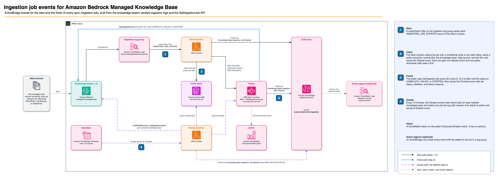

# Ingestion job events for Amazon Bedrock Managed Knowledge Base

This sample publishes Amazon EventBridge events when a sync (an ingestion job) on Amazon Bedrock Managed Knowledge Base starts and when it finishes. With these events, you can start a workflow, send an alert, or update a dashboard from an EventBridge rule. You deploy an AWS Cloud Development Kit (AWS CDK) app that builds the events from the knowledge base's [vended ingestion logs](https://docs.aws.amazon.com/bedrock/latest/userguide/kb-managed-observability.html) and from the [`GetIngestionJob`](https://docs.aws.amazon.com/bedrock/latest/APIReference/API_agent_GetIngestionJob.html) API. Then you start a sync and read the events.

## How it works

A managed knowledge base can deliver its `APPLICATION_LOGS` to a CloudWatch Logs log group. The job-level records (`event_type` `StartIngestionJob.StatusChanged`) include a record whose `event.ingestion_job_status` is `INGESTION_JOB_STARTED` when a job starts. `GetIngestionJob` returns a job's status, statistics, and failure reasons. The pattern uses both:

```
KB 1..N ──log delivery──► log group /aws/vendedlogs/bedrock/<name>
                               │ subscription filter: $.event.ingestion_job_status = "INGESTION_JOB_STARTED"
                               ▼
                         Start function ──┐
                                          │ claim the job in DynamoDB (once per job)
EventBridge Scheduler ──► Sweep function ─┤ start the poller (execution name = <kbId>-<dsId>-<jobId>)
 (every 15 min: ListDataSources,          │ PutEvents "Knowledge Base Ingestion Job Started"
  ListIngestionJobs per data source)      ▼
                         Step Functions poller, one execution per job:
                         Wait 60–70 s → GetIngestionJob → terminal? ──no──► loop
                                                              │ yes
                                                              ▼
                         PutEvents "Knowledge Base Ingestion Job Finished" (status COMPLETE, FAILED, or STOPPED)
```

1. **Start.** A standard per-log-group subscription filter (`AWS::Logs::SubscriptionFilter`) sends each start record to the Start function, usually within seconds after the job begins.
2. **Claim.** The Start function claims the job with a conditional write to a DynamoDB table, starts a Step Functions execution named `<kbId>-<dsId>-<jobId>`, sends the Started event, and marks the job announced. The claim makes sure each job gets one Started event and one poller, whichever path sees it first. Every job API takes the knowledge base ID, the data source ID, and the job ID, so the claim key (`job#<kbId>#<dsId>#<jobId>`) and the execution name include all three.
3. **Finish.** The poller calls `GetIngestionJob` every 60 s plus 0–10 s of random jitter until the status is COMPLETE, FAILED, or STOPPED. It then sends the Finished event with the status, statistics, and failure reasons.
4. **Sweep.** Every 15 minutes, the Sweep function lists recent jobs for each tracked knowledge base, at 2 requests per second per API. It claims any job that the start path didn't announce, such as one whose start record the Start function didn't process. Its Started event has `detectedBy: RECONCILIATION`.

The Started and Finished events cover syncs that you start and those that run on a data source's [sync schedule](https://docs.aws.amazon.com/bedrock/latest/userguide/kb-managed-sync.html#kb-managed-sync-schedule).

The following diagram shows the resources the stack deploys, numbered by the steps above.



*The start path (steps 1–2) and the sweep path (step 4) claim each job once and send the Started event. The poller sends the Finished event (step 3).*

## What gets deployed

`cdk deploy` creates one AWS CloudFormation stack, `ingestion-events-<name>` (`ingestion-events-demo` by default), with these resources:

| Resource | Details |
| --- | --- |
| Log delivery (default mode only) | One CloudWatch Logs delivery source per knowledge base (`<name>-<kbId>`, type `APPLICATION_LOGS`) and one delivery each, to one delivery destination (`<name>-cwl`) and one log group, `/aws/vendedlogs/bedrock/<name>`. In existing-log-group mode, none of these are created (see [Deploy](#deploy)). |
| Subscription filter | `<name>-ingestion-started` on the ingestion log group, pattern `{ $.event.ingestion_job_status = "INGESTION_JOB_STARTED" }`, to the Start function. It uses 1 of the 5 subscription filters a log group can have ([CloudWatch Logs quotas](https://docs.aws.amazon.com/AmazonCloudWatch/latest/logs/cloudwatch_limits_cwl.html)). |
| Start function | AWS Lambda, Python 3.14, 128 MB, 60 s. Decodes the start records and claims each job. |
| Sweep function | Lambda, Python 3.14, 256 MB, 240 s, reserved concurrency 1. Invoked by an EventBridge Scheduler schedule every 15 minutes. |
| Claim table | Amazon DynamoDB, on demand, point-in-time recovery on, TTL 7 days on claims. Holds one claim item per job (`job#<kbId>#<dsId>#<jobId>`) and one watermark item per data source (`ds#<kbId>#<dsId>`). |
| Poller | AWS Step Functions Standard state machine (JSONata), logging to `/aws/vendedlogs/states/<name>-poller` without execution data |
| Alarm | Amazon CloudWatch alarm on the poller's `ExecutionsFailed` metric. It has no actions; add one to be notified. |
| Event capture (`captureEvents`, default on) | An EventBridge rule on the bus that matches the pattern's `source` and writes every event to `/ingestion-events/<name>/events`, plus the CloudWatch Logs resource policy that lets EventBridge write there |
| Demo knowledge base (`deployDemo`, default on) | An S3 bucket (Block Public Access on, ACLs off, SSE-S3, TLS required) with the files in `data/docs/` under `docs/`; an IAM role that can only list the bucket and read its objects; a managed knowledge base `<name>-demo-kb`; and an S3 data source `<name>-demo-s3` with no sync schedule. The deploy doesn't start a sync. |
| IAM roles | One per function, one for the state machine, and one for the scheduler, each limited to the actions in [Security](#security) |
| CDK helper functions and log groups | AWS CDK adds Lambda functions to upload the demo files and to empty the bucket when you delete the stack. They run only during `cdk deploy` and `cdk destroy`. |

Every log group keeps events for 30 days and is deleted with the stack.

## Repository structure

```
.
├── infra/                                  AWS CDK app (TypeScript)
│   ├── bin/app.ts                          Context values and cdk-nag checks
│   ├── lib/ingestion-events.ts             The IngestionEvents construct
│   ├── lib/ingestion-events-stack.ts       The stack: construct, demo knowledge base, event capture
│   ├── lib/nag-suppressions.ts             Each accepted cdk-nag finding, with its reason
│   ├── lib/log-groups.ts                   Explicit log groups for the CDK helper functions
│   └── test/                               Jest tests, including cdk-nag
├── functions/                              Lambda code: claim.py (shared), start.py, sweep.py
├── tests/                                  Offline pytest tests for the functions
├── data/docs/                              Demo files
└── docs/                                   The architecture diagram and its draw.io source
```

## Sample files

`data/docs/` holds three short Markdown runbooks. The runbooks are fictitious.

## Getting this sample

This sample is in the [sample-managed-knowledge-base-patterns](https://github.com/aws-samples/sample-managed-knowledge-base-patterns) repository, along with other patterns that share no code with it. To get only this one, have Git fetch only this directory. With `--filter=blob:none`, the file contents of the other patterns are never downloaded.

```bash
# Clone the repository structure without any file contents
git clone --filter=blob:none --sparse \
  https://github.com/aws-samples/sample-managed-knowledge-base-patterns.git
cd sample-managed-knowledge-base-patterns

# Fetch only this sample
git sparse-checkout set ingestion-events
cd ingestion-events
```

Commands in this README run from the `ingestion-events` directory unless a step says to change into `infra/`.

## Prerequisites

- An AWS account in a Region where Amazon Bedrock Managed Knowledge Base is available. See [Supported AWS Regions](https://docs.aws.amazon.com/bedrock/latest/userguide/kb-managed-regions.html). The sample was tested in US East (N. Virginia) (`us-east-1`).
- Node.js 24 and npm, for the AWS CDK app. Tested with Node.js 24.21.0.
- [uv](https://docs.astral.sh/uv/), for the Python tests. Python 3.10 or later runs the tests; the Lambda functions run on the managed Python 3.14 runtime.
- The AWS CLI v2, for the commands in [Try it](#try-it).
- The account and Region bootstrapped for AWS CDK (`npx cdk bootstrap`).
- AWS credentials for an identity that can deploy and delete CDK stacks with the resources in [What gets deployed](#what-gets-deployed), including IAM roles. To try it, the identity also needs `cloudformation:DescribeStacks`, `bedrock:StartIngestionJob`, `bedrock:GetIngestionJob`, `bedrock:StopIngestionJob`, `logs:FilterLogEvents` (for `aws logs tail`), and `lambda:InvokeFunction` on the Sweep function.
- To track your own knowledge bases, their knowledge base IDs. Each one must be a managed knowledge base. For knowledge bases that already deliver their logs, see [Deploy](#deploy).

## Cost

The stack has no always-on compute. These charges apply; check each pricing page for your Region:

- **Standing cost, until you delete the stack:**
  - EventBridge Scheduler: 2,880 sweep runs a month at the 15-minute default. Each run is a Lambda invocation that makes one `ListDataSources` call per knowledge base and at least one `ListIngestionJobs` call per data source.
  - The CloudWatch alarm (one standard metric alarm).
  - DynamoDB on-demand storage and point-in-time recovery for a table of small items.
  - CloudWatch Logs storage for the 30 days of logs.
  - With the demo: knowledge base storage for 4 small files (325 bytes in total), and S3 storage for them and the CDK assets.
- **Per sync:**
  - CloudWatch Logs ingestion of every record the knowledge base delivers, including the [document-level record](https://docs.aws.amazon.com/bedrock/latest/userguide/kb-managed-observability.html) for each document. Log ingestion is the cost that grows with your document count. The subscription filter passes only start records to Lambda, but the log group ingests all of them.
  - Step Functions Standard state transitions: about 5 per poll (one poll per 60–70 s of job run time) plus a few per job. Retries add more.
  - One Start function invocation, a few DynamoDB writes, two custom events to EventBridge (Started and Finished), and the capture rule's delivery to CloudWatch Logs.
  - With the demo: ingestion of the demo files each time you sync.

For prices, see [AWS Step Functions pricing](https://aws.amazon.com/step-functions/pricing/), [AWS Lambda pricing](https://aws.amazon.com/lambda/pricing/), [Amazon DynamoDB pricing](https://aws.amazon.com/dynamodb/pricing/), [Amazon CloudWatch pricing](https://aws.amazon.com/cloudwatch/pricing/), [Amazon EventBridge pricing](https://aws.amazon.com/eventbridge/pricing/) (includes Scheduler), [Amazon Bedrock pricing](https://aws.amazon.com/bedrock/pricing/), and [Amazon S3 pricing](https://aws.amazon.com/s3/pricing/). [Clean up](#clean-up) when you finish.

## Deploy

```bash
export AWS_REGION=<region>
make install          # or: uv sync --frozen, and npm ci in infra/
cd infra
npx cdk bootstrap     # once per account and Region
npx cdk deploy
```

The stack creates IAM roles and policies, so `cdk deploy` lists those IAM changes and asks `Do you wish to deploy these changes? (y/n)`. Review the changes, then enter `y`. To keep the sweep's start time fixed across deploys, pass `-c sweepEpoch=<ISO timestamp>` (see [Configuration](#configuration)).

The pattern has three deployment modes:

| Mode | Command | When to use it |
| --- | --- | --- |
| Demo (default) | `npx cdk deploy` | To try the pattern without a knowledge base. Deploys the demo knowledge base and its log delivery. |
| Attach to existing knowledge bases | `npx cdk deploy -c name=prod -c deployDemo=false -c knowledgeBaseIds=KBID1,KBID2` | For knowledge bases that don't deliver their logs yet. The stack adds a delivery source and delivery for each. |
| Existing log group | `npx cdk deploy -c name=prod -c deployDemo=false -c knowledgeBaseIds=KBID1 -c existingLogGroupName=<log group>` | For knowledge bases that already deliver `APPLICATION_LOGS` to a CloudWatch Logs log group. The stack creates no delivery resources and adds one subscription filter to that group. |

Attach mode creates a delivery source for each knowledge base. If a knowledge base already has one, for example because you turned on log delivery in the console, use existing-log-group mode with the log group it delivers to. One delivery source can send logs to several destinations ([`PutDeliverySource`](https://docs.aws.amazon.com/AmazonCloudWatchLogs/latest/APIReference/API_PutDeliverySource.html)). You can also create a delivery from that source to a new log group and point existing-log-group mode at it.

In existing-log-group mode:
- The group's other subscription filters count toward the 5 a log group can have.
- The group can hold records from knowledge bases you don't list. The Start function ignores them and logs `untracked knowledge base`.

You can't combine the demo with `existingLogGroupName`; the stack rejects it at synth time.

To track a knowledge base with a SharePoint data source, first set up the data source as described in [Microsoft SharePoint](https://docs.aws.amazon.com/bedrock/latest/userguide/kb-managed-ds-sharepoint.html) in the *Amazon Bedrock User Guide*. Then deploy in attach or existing-log-group mode with the knowledge base's ID.

The pattern doesn't depend on the data source's connector. It reads only what the knowledge base itself provides, which is the job-level start record in the knowledge base's `APPLICATION_LOGS` and the `GetIngestionJob`, `ListIngestionJobs`, and `ListDataSources` APIs. It reads no connector-specific fields. As a result, the pattern works with data sources of any [managed data source connector](https://docs.aws.amazon.com/bedrock/latest/userguide/kb-managed-connect-ds.html) that syncs through ingestion jobs, such as Amazon S3, Microsoft SharePoint, Microsoft OneDrive, Confluence, Salesforce, or Box. The sample has been run with Amazon S3 and Microsoft SharePoint data sources.

The stack prints these outputs:

| Output | Description |
| --- | --- |
| `DemoKnowledgeBaseId`, `DemoDataSourceId`, `DemoKnowledgeBaseRoleName`, `BucketName` | The demo knowledge base, its data source, its role, and its bucket (demo only) |
| `EventLogGroup` | The log group that captures every event (`captureEvents` only) |
| `IngestionLogGroup` | The log group the subscription filter is on |
| `StateMachineArn` | The poller |
| `ClaimTableName` | The claim table |
| `StartFunctionName`, `SweepFunctionName` | The two functions. Invoke the Sweep function to run a sweep now. |
| `FailedExecutionsAlarmName` | The `ExecutionsFailed` alarm |

## Try it

With the demo stack deployed:

```bash
STACK=ingestion-events-demo    # ingestion-events-<name> if you passed -c name=<name>
output() {
  aws cloudformation describe-stacks --stack-name $STACK \
    --query "Stacks[0].Outputs[?OutputKey=='$1'].OutputValue" --output text
}
KB=$(output DemoKnowledgeBaseId)
DS=$(output DemoDataSourceId)
EVENTS=$(output EventLogGroup)

aws bedrock-agent start-ingestion-job --knowledge-base-id $KB --data-source-id $DS
aws logs tail $EVENTS --follow
```

The Started event appears a few seconds after the job starts. The Finished event appears within one poll interval plus jitter (70 s with the defaults) of the job's end. Press Ctrl+C to stop following the log group.

To see a STOPPED job, start a sync, check its status until `GetIngestionJob` reports `IN_PROGRESS`, then stop it:

```bash
JOB=$(aws bedrock-agent start-ingestion-job --knowledge-base-id $KB --data-source-id $DS \
  --query ingestionJob.ingestionJobId --output text)
aws bedrock-agent get-ingestion-job --knowledge-base-id $KB --data-source-id $DS \
  --ingestion-job-id $JOB --query ingestionJob.status --output text
aws bedrock-agent stop-ingestion-job --knowledge-base-id $KB --data-source-id $DS --ingestion-job-id $JOB
```

The Finished event reports STOPPED after `GetIngestionJob` does.

The sweep runs every 15 minutes. To run it now, invoke the Sweep function:

```bash
aws lambda invoke --function-name $(output SweepFunctionName) /dev/stdout
```

It prints counts such as `{"knowledgeBases": 1, "dataSources": 1, "claimed": 0, "skipped": 2, ...}`, followed by the invocation's status code.

## Event reference

Both events go to the bus named by `eventBusName` (the `default` bus by default) with `source` `custom.bedrock.kb-ingestion`. These are the events of a job that failed because its role was denied access to the bucket:

```json
{
  "detail-type": "Knowledge Base Ingestion Job Started",
  "source": "custom.bedrock.kb-ingestion",
  "resources": ["arn:aws:bedrock:us-east-1:111122223333:knowledge-base/EXAMPLEKB1"],
  "detail": {
    "version": "1",
    "knowledgeBaseId": "EXAMPLEKB1",
    "knowledgeBaseArn": "arn:aws:bedrock:us-east-1:111122223333:knowledge-base/EXAMPLEKB1",
    "dataSourceId": "EXAMPLEDS1",
    "ingestionJobId": "EXAMPLEJB1",
    "status": "STARTED",
    "observedAt": "2026-11-15T23:25:29.596Z",
    "trigger": "UNKNOWN",
    "detectedBy": "LOG_SUBSCRIPTION"
  }
}
```

```json
{
  "detail-type": "Knowledge Base Ingestion Job Finished",
  "source": "custom.bedrock.kb-ingestion",
  "resources": [
    "arn:aws:bedrock:us-east-1:111122223333:knowledge-base/EXAMPLEKB1",
    "arn:aws:states:us-east-1:111122223333:stateMachine:IngestionEventsPoller6889D928-1234567890ab",
    "arn:aws:states:us-east-1:111122223333:execution:IngestionEventsPoller6889D928-1234567890ab:EXAMPLEKB1-EXAMPLEDS1-EXAMPLEJB1"
  ],
  "detail": {
    "version": "1",
    "knowledgeBaseId": "EXAMPLEKB1",
    "knowledgeBaseArn": "arn:aws:bedrock:us-east-1:111122223333:knowledge-base/EXAMPLEKB1",
    "dataSourceId": "EXAMPLEDS1",
    "ingestionJobId": "EXAMPLEJB1",
    "status": "FAILED",
    "startedAt": "2026-11-15T23:25:28.781Z",
    "updatedAt": "2026-11-15T23:26:30.190Z",
    "durationSeconds": 61,
    "statistics": {
      "numberOfDocumentsScanned": 0, "numberOfNewDocumentsIndexed": 0, "numberOfModifiedDocumentsIndexed": 0,
      "numberOfDocumentsDeleted": 0, "numberOfDocumentsFailed": 0, "numberOfDocumentsSkipped": 0,
      "numberOfMetadataDocumentsScanned": 0, "numberOfMetadataDocumentsModified": 0
    },
    "hasDocumentFailures": false,
    "failureReasons": ["[\"User: arn:aws:sts::111122223333:assumed-role/... is not authorized to perform: s3:ListBucket ... with an explicit deny ...\"]"],
    "failureReasonsTruncated": false,
    "trigger": "UNKNOWN",
    "detectedBy": "LOG_SUBSCRIPTION"
  }
}
```

The Finished event's `resources` has three ARNs. The poller sets the knowledge base ARN, and the Step Functions EventBridge integration adds the state machine and execution ARNs. The Started event has only the knowledge base ARN.

`detail` fields:

| Field | Started | Finished | Meaning |
| --- | --- | --- | --- |
| `version` | yes | yes | `"1"` |
| `knowledgeBaseId`, `knowledgeBaseArn`, `dataSourceId`, `ingestionJobId` | yes | yes | The job. Use (`knowledgeBaseId`, `dataSourceId`, `ingestionJobId`, detail-type) to deduplicate. |
| `status` | `STARTED` | see below | |
| `observedAt` | yes | no | When the start was seen: the log record's timestamp, or the sweep's own time |
| `startedAt` | sweep only | yes | From the API (`ListIngestionJobs` or `GetIngestionJob`). Started events from the log path include `observedAt` instead. |
| `updatedAt`, `statistics`, `failureReasons` | no | yes | From the final `GetIngestionJob` call. Timestamps are cut to milliseconds. |
| `durationSeconds` | no | yes | `updatedAt` − `startedAt`, rounded |
| `textReadyAt` | no | when the API returns it | Passed through from `GetIngestionJob` |
| `hasDocumentFailures` | no | yes | `numberOfDocumentsFailed > 0`. `status` reports the job, so check this field on COMPLETE and STOPPED jobs too. |
| `failureReasonsTruncated` | no | yes | `true` when the event includes fewer than all reasons. The event includes at most 20 reasons of at most 2,000 characters each. |
| `error`, `cause` | no | `UNKNOWN_ERROR` only | The Step Functions error name and a shortened message |
| `trigger` | yes | yes | `UNKNOWN` in version 1. The field is reserved for telling manual syncs from scheduled ones. |
| `detectedBy` | yes | yes | `LOG_SUBSCRIPTION` or `RECONCILIATION` (the sweep). Finished has the value of the path that started the poller. |

Finished `status` values:

| Status | Meaning |
| --- | --- |
| `COMPLETE`, `FAILED`, `STOPPED` | The job's terminal status from `GetIngestionJob` |
| `UNKNOWN_TIMEOUT` | `maxJobDuration` (24 h by default) passed since the poller started without a terminal status. The poller reports it at its next poll, so within one poll interval plus jitter and any API retries. The execution then fails. |
| `UNKNOWN_ERROR` | `GetIngestionJob` returned an error that retrying won't fix, such as `BedrockAgent.ResourceNotFoundException` (the knowledge base or data source was deleted) or `BedrockAgent.AccessDeniedException`. The execution then fails. |

Each `failureReasons` entry is the API's string, passed through unchanged, so an entry can itself be a JSON-encoded array, as in the example.

Example rule patterns:

```json
{"source": ["custom.bedrock.kb-ingestion"],
 "detail-type": ["Knowledge Base Ingestion Job Finished"],
 "detail": {"status": ["FAILED", "UNKNOWN_ERROR", "UNKNOWN_TIMEOUT"]}}
```

```json
{"source": ["custom.bedrock.kb-ingestion"],
 "detail-type": ["Knowledge Base Ingestion Job Finished"],
 "detail": {"knowledgeBaseId": ["EXAMPLEKB1"], "hasDocumentFailures": [true]}}
```

Make consumers idempotent on (`knowledgeBaseId`, `dataSourceId`, `ingestionJobId`, detail-type). The claim table allows one Started event per job in normal operation. If a Start function stops after it sends the event and before it marks the claim, a later run can send the event again.

## Configuration

Pass these context values to `cdk deploy` with `-c key=value`, or edit `infra/cdk.json`. Booleans are `true` or `false`.

| Key | Default | Description |
| --- | --- | --- |
| `name` | `demo` | Names the stack `ingestion-events-<name>` and prefixes the resource names. 2 to 32 lowercase letters, numbers, and single hyphens. |
| `deployDemo` | `true` | Deploy the demo knowledge base and track it first |
| `knowledgeBaseIds` | (empty) | Comma-separated IDs of existing managed knowledge bases to track |
| `existingLogGroupName` | (empty) | Existing-log-group mode: put the filter on this group and create no delivery resources |
| `eventBusName` | `default` | The name of an existing event bus for both events. Create a custom bus before you deploy with its name. |
| `eventSource` | `custom.bedrock.kb-ingestion` | The events' `source` |
| `pollIntervalSeconds` | `60` | Seconds between polls. With the 24 h `maxJobDuration`, the minimum is 57, so that a poller execution stays within the 25,000 history events of a Standard execution ([Step Functions quotas](https://docs.aws.amazon.com/step-functions/latest/dg/service-quotas.html)). |
| `jitterSeconds` | `10` | Random 0 to `jitterSeconds` added to each wait, to spread polls. `0` turns it off. |
| `maxJobDurationHours` | `24` | How long after it starts the poller reports `UNKNOWN_TIMEOUT` for a job that hasn't finished. The poller also stops after `maxJobDuration` / `pollIntervalSeconds` polls, which keeps its history within the quota. |
| `sweepEnabled` | `true` | Turns the sweep's schedule on or off. The Sweep function is always deployed, so you can still invoke it yourself. |
| `sweepIntervalMinutes` | `15` | How often the sweep runs |
| `sweepRps` | `2` | Requests per second the sweep makes to `ListDataSources` and to `ListIngestionJobs`, each. Up to 10. As of this writing, each API allows 10 requests per second per account ([Amazon Bedrock quotas](https://docs.aws.amazon.com/general/latest/gr/bedrock.html)), so the default leaves most of that rate for other callers. |
| `sweepEpoch` | the synth time | ISO timestamp. The sweep never announces jobs that started before it. Without a value, each deploy moves it and updates the Sweep function. |
| `captureEvents` | `true` | Deploy the capture rule and log group |
| `demoSyncDay` | (empty) | A day such as `MONDAY` gives the demo data source a weekly scheduled sync. Empty means no schedule. |

The `IngestionEvents` construct in `infra/lib/ingestion-events.ts` takes the same settings as props, plus `startFunctionTimeout` (60 s), `sweepFunctionTimeout` (240 s), and `claimLeaseSeconds` (the longer timeout plus 60 s). The construct validates them at synth time.

Poll load: as of this writing, an account can run up to 200 managed knowledge base ingestion jobs at once in most Regions ([Amazon Bedrock quotas](https://docs.aws.amazon.com/general/latest/gr/bedrock.html)). `GetIngestionJob` allows 10 requests per second per account. With one poll per job every 60 s or more, the poller makes at most about 3.3 `GetIngestionJob` requests per second, even when every allowed job runs at once.

## Scale

These estimates come from the service quotas:

- Start discovery uses push delivery, and one subscription filter covers every knowledge base that delivers to the log group. Its cost grows with the number of syncs, not the number of knowledge bases.
- Finish polling grows with the number of running jobs, which the account's concurrent ingestion job quota bounds.
- The sweep makes one `ListIngestionJobs` call per data source per run, so it runs every 15 minutes as a fallback. The start path does the time-sensitive work. At `sweepRps` 2, one run over 1,000 knowledge bases with one data source each takes about 500 s. For that many, set the construct's `sweepFunctionTimeout` above 500 s (the default is 240 s); the lease follows the longer timeout.
- The pattern uses a standard per-log-group subscription filter. Filters on other log groups don't count toward this group's 5.

The construct lists each tracked knowledge base in the Lambda environment and in its IAM policies, and creates two delivery resources per knowledge base in its own stack. For a few hundred knowledge bases or more, create the deliveries outside the stack, use existing-log-group mode, and adapt the construct to track knowledge bases without listing each one. As of this writing, a CloudFormation stack can have up to 500 resources ([CloudFormation quotas](https://docs.aws.amazon.com/AWSCloudFormation/latest/UserGuide/cloudformation-limits.html)).

## Design choices

| Choice | Why | Alternatives considered |
| --- | --- | --- |
| Start from the `INGESTION_JOB_STARTED` log record | The knowledge base writes it when a job starts, and the subscription filter pushes it to Lambda within seconds. One filter covers every knowledge base that delivers to the log group. | **AWS CloudTrail `StartIngestionJob` events**: record calls to the API, so they cover the syncs you start through the API, and include failed calls to filter out. **Polling `ListIngestionJobs`**: one call per data source, so the pattern uses it only for the sweep. |
| Finish from polling `GetIngestionJob` | It returns the terminal status, the statistics, and the failure reasons in one response, which are the fields that the Finished event includes | **Polling `ListIngestionJobs`**: one call per data source covers several jobs, but a job summary has no failure reasons ([`IngestionJobSummary`](https://docs.aws.amazon.com/bedrock/latest/APIReference/API_agent_IngestionJobSummary.html)). |
| A Step Functions poller per job | Standard workflows are billed per state transition, not for time spent waiting ([pricing](https://aws.amazon.com/step-functions/pricing/)). The execution history shows every poll, and the retries and the poll cap are part of the state machine. | A Lambda function on a schedule that polls every running job |
| The claim step starts the poller; no EventBridge rule targets the state machine | Starting the execution in the claim step lets the pattern name it after the job, so a repeated Started event can't start a second poller. The Started event is for consumers only. | **EventBridge rule → state machine** on the Started event |
| A DynamoDB claim plus an execution name, both scoped to the knowledge base, data source, and job | The start path and the sweep can both see a job. The conditional write gives one Started event per job, and a Standard execution with the same name and input as a running one returns that execution instead of starting another ([`StartExecution`](https://docs.aws.amazon.com/step-functions/latest/apireference/API_StartExecution.html)). Every job API takes all three IDs, so the key and the name do too. Each ID is 10 letters and digits, so the name `<kbId>-<dsId>-<jobId>` is 32 characters, within the 80-character limit for execution names. | Execution name only: would still send two Started events |
| A reconciliation sweep | It announces any job whose start record the Start function didn't process, within one sweep interval. Lambda discards an asynchronous event once its retries or maximum event age run out ([asynchronous invocation](https://docs.aws.amazon.com/lambda/latest/dg/invocation-async.html)), so the sweep is the fallback. | Lambda retries alone |
| A standard per-log-group `AWS::Logs::SubscriptionFilter` | It affects only the pattern's log group and uses 1 of its 5 filters | **An account-level subscription filter policy** (`PutAccountPolicy`): applies across the account's log groups, which is broader than the pattern needs |
| One `Knowledge Base Ingestion Job Finished` detail-type with `detail.status` | One rule can match every outcome, or one outcome with a `status` filter | **Three detail-types** (Completed, Failed, Stopped). Would change only the poller's emit states. |
| The `default` bus | Rules on the default bus need no extra setup. The bus is configurable. | A custom bus, set with `eventBusName` |
| Existing-log-group mode | Knowledge bases that already deliver their logs keep their delivery, and the pattern adds one subscription filter to that log group | A second delivery from the existing delivery source to the pattern's own log group, which you can create yourself; the construct doesn't create it |
| PutEvents responses are checked | `PutEvents` reports failed entries in `FailedEntryCount` ([`PutEvents`](https://docs.aws.amazon.com/eventbridge/latest/APIReference/API_PutEvents.html)). The functions release the claim and raise, and the poller's task fails with `EventBridge.FailedEntry` and retries. | Treating every response as success |

## Troubleshooting

| Symptom | What to check |
| --- | --- |
| The `ExecutionsFailed` alarm is in ALARM | Open the failed poller execution in the Step Functions console. `UnknownTimeout` or `UnknownError` is the Fail state of an `UNKNOWN_*` Finished event; `EventBridge.FailedEntry` means the Finished event wasn't accepted. An execution also fails if its history reaches the 25,000-event quota of a Standard execution. |
| A Finished event with `UNKNOWN_ERROR` | `detail.error` names the error. `BedrockAgent.AccessDeniedException` on a knowledge base you track means the poller role doesn't list it; redeploy with it in `knowledgeBaseIds`. |
| No events at all | Check that `eventBusName` names an existing bus in the stack's account and Region, and that your rule is on that bus. Check that the knowledge base is in `knowledgeBaseIds`: the Start function logs `untracked knowledge base` for others. Check that the ingestion log group receives records. |
| `cdk deploy` fails on the delivery source of a knowledge base | The knowledge base might already have a delivery source. Redeploy in existing-log-group mode with the log group it delivers to. |
| `cdk deploy` fails on the subscription filter in existing-log-group mode | The log group might already have 5 subscription filters, the most it can have. Remove one, or deliver the logs to another log group. |
| A job got its Started event late, with `detectedBy: RECONCILIATION` | The Start function didn't process the start record. Check its errors, throttles, and `AsyncEventsDropped` metric. |
| Every deploy changes the Sweep function | Pass a fixed `-c sweepEpoch=<ISO timestamp>`. |
| `cdk deploy` reports that the environment isn't bootstrapped | Run `npx cdk bootstrap` in `infra/` once for the account and Region. |

## Development

```bash
make lint    # ruff, mypy --strict, tsc
make test    # pytest (offline), jest (including cdk-nag)
make synth   # cdk synth through cdk.json, without deploying
```

`cdk synth` fails on any cdk-nag AwsSolutions finding that isn't acknowledged. The acknowledgements in `infra/lib/nag-suppressions.ts` say what to harden before production use, such as AWS X-Ray tracing on the state machine.

## Clean up

To avoid ongoing charges, delete the stack, passing the same `-c` values you deployed with:

```bash
cd infra
npx cdk destroy
```

`cdk destroy` asks `Are you sure you want to delete: ingestion-events-<name> (y/n)`; enter `y`. With the demo, deleting the data source also removes its indexed content, which can take several minutes, so the whole deletion can take 10 minutes or more.

The stack's removal policies delete every resource that the stack created. These include the demo knowledge base, its data source and indexed content, the bucket and its objects, and the delivery resources. They also include the subscription filter, the table, the state machine, the functions, the schedule, the rule, the alarm, the roles, and every log group. In existing-log-group mode, the log group and its delivery stay, because the stack didn't create them; only the stack's filter is removed. The CDK bootstrap resources stay.

Use `cdk destroy` rather than the console to delete the resources, so the stack and its resources stay in sync.

## Security

This sample is for demonstration. Review the cdk-nag acknowledgements and your organization's requirements before you adapt it.

- **IAM.** Each role allows only what its code calls, and the Amazon Bedrock actions authorize against the knowledge base ARN:
  - Start function: `events:PutEvents` on the bus; `dynamodb:GetItem`, `PutItem`, `UpdateItem`, and `DeleteItem` on the table; `states:StartExecution` on the poller.
  - Sweep function: the same, plus `bedrock:ListDataSources` and `bedrock:ListIngestionJobs` on the tracked knowledge bases.
  - Poller: `bedrock:GetIngestionJob` on the tracked knowledge bases and `events:PutEvents` on the bus, plus the CloudWatch Logs delivery actions CDK adds for state machine logging, on `*`.
  - Scheduler: `lambda:InvokeFunction` on the Sweep function.
- **Event contents.** `failureReasons` can name IAM roles and buckets. Every identity that can create rules on the bus can read these events.
- **Resource policies.** The Start function's invoke permission for `logs.amazonaws.com` is limited to the ingestion log group's ARN, without an `aws:SourceAccount` condition. The capture log group's resource policy also has no `aws:SourceAccount` condition.
- **Demo data source.** Document-level access control is off (`aclEnabled: false`). The demo files are fictitious runbooks.

Read [SECURITY.md](SECURITY.md) before you change the IAM statements, the log groups, or the event capture. It lists what each one exposes, including the document titles and URIs in the ingestion log group, and how to report a vulnerability.

## Contributing

See [CONTRIBUTING.md](../CONTRIBUTING.md).

## License

MIT-0. See [LICENSE](../LICENSE).
