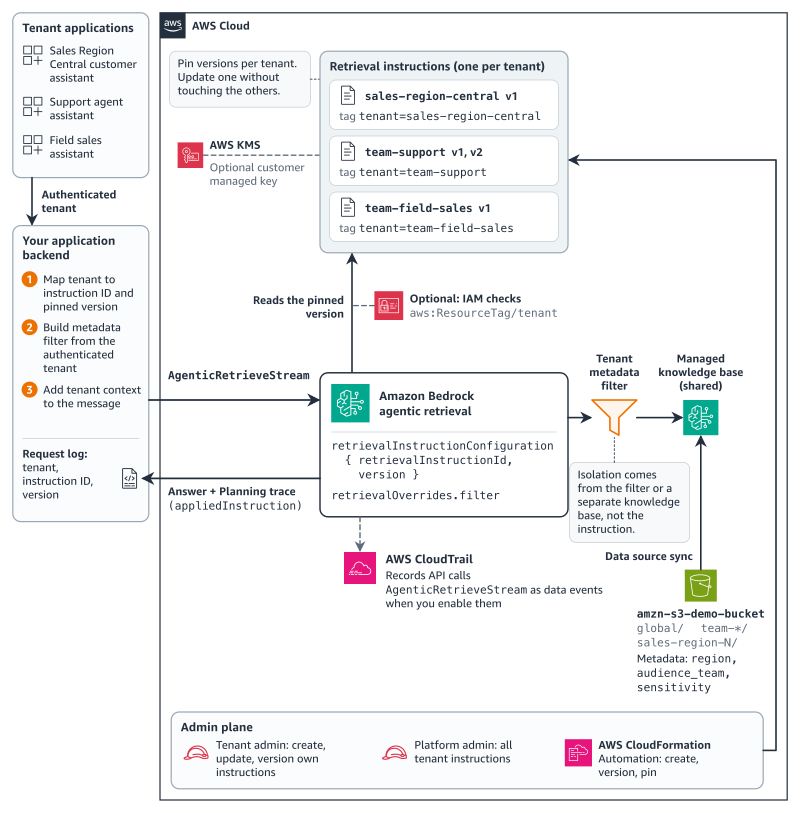
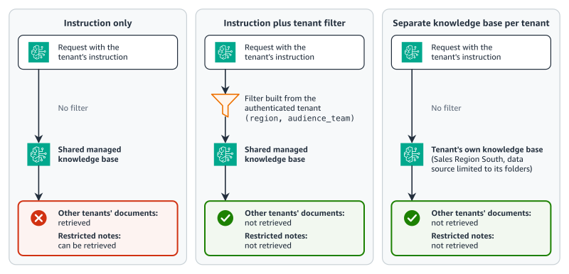

# Per-tenant retrieval instructions for Amazon Bedrock Managed Knowledge Base

Give each tenant of one shared
[Amazon Bedrock Managed Knowledge Base](https://docs.aws.amazon.com/bedrock/latest/userguide/kb-build-managed.html)
its own voice, answer format, and pinned retrieval instruction version, while a
metadata filter built on the server keeps each tenant to its own documents. The sample
is the companion code of the AWS blog post "Customize answers per tenant in Amazon
Bedrock Managed Knowledge Base".



_Figure 1: One managed knowledge base with per-tenant instructions and filters._

The infrastructure is an AWS CDK app. The retrieval instructions, their versions, and
every request are SDK code, in Python and in TypeScript, with the same commands and the
same output. Design decisions and the service behavior behind them are in
[DESIGN.md](DESIGN.md).

## How it works

The fictitious company AnyCompany Smart Home sells a home controller and room sensors in
three sales regions. Its documents serve six tenants, three sales regions and three
internal teams, from one knowledge base:

| Tenant                  | Kind   | Retrieves                                                          | Answers                                           |
| ----------------------- | ------ | ------------------------------------------------------------------ | ------------------------------------------------- |
| `sales-region-north`    | region | Global and Sales Region North customer documents                   | English, dates as 2026-12-31, amounts as $5.00    |
| `sales-region-central`  | region | Global and Sales Region Central customer documents                 | Spanish, dates as 31/12/2026, amounts as 5,00 USD |
| `sales-region-south`    | region | Global and Sales Region South customer documents                   | English, dates as 1 Mar 2027, amounts as USD 5.00 |
| `team-support`          | team   | Every region's customer documents and the support team's notes     | A short ticket note                               |
| `team-field-sales`      | team   | Every region's customer documents and the field sales team's notes | A deal brief                                      |
| `team-legal-compliance` | team   | Every region's customer documents and the legal team's notes       | A risk memo that cites each document's version    |

For each request, the application does four things on the server, from the
authenticated tenant:

1. It picks the tenant's retrieval instruction and the version pinned in the tenant's
   release configuration.
2. It builds the tenant's metadata filter (`region` and `audience_team`), never from the
   question or other user input.
3. It puts a short tenant line, such as `Customer sales region: Sales Region Central.`,
   before the question.
4. It calls `AgenticRetrieveStream` on the shared knowledge base with all three.

Optional AWS Identity and Access Management (IAM) roles show how tag conditions limit
which instruction a tenant role can apply. The trace and AWS CloudTrail record which
instruction version answered.

A retrieval instruction changes how an answer is written. It isn't an authorization or
data-isolation boundary: the filter is what keeps a tenant to its own documents. See
[SECURITY.md](SECURITY.md).



_Figure 2: Where tenant isolation comes from._

## What gets deployed

`npm run deploy` creates one AWS CloudFormation stack, `RetrievalInstructionsSample`:

- An Amazon S3 bucket with the 32 synthetic documents and their metadata files under
  `docs/`. Public access is blocked, objects are encrypted with S3 managed keys, and
  requests must use TLS.
- A shared managed knowledge base, `retrieval-instructions-sample-shared`, with an S3
  data source over `docs/`, and its service role.
- A Sales Region South knowledge base, `retrieval-instructions-sample-south`, with a data
  source over `docs/global/` and `docs/sales-region-south/` (16 documents), and its own
  service role.
- An ingestion job for each knowledge base, started on deploy, and two AWS Lambda
  functions that CDK uses to upload the documents and start the jobs, with their log
  groups.

The SDK commands create 7 retrieval instructions in your account and Region, each with
version 1: one for each tenant, plus `assistant-structured-json` for the JSON example.
With `--combined`, they create 4 more. Everything the sample creates carries the tag
`app=retrieval-instructions-sample`.

Optional parts. None of them is needed for the core walkthrough:

- **Tenant roles.** An applier role and a tenant admin role for one tenant, plus a
  platform admin role. Created only when you deploy with `-c trustedPrincipalArn=...`.
  See [Check the tenant roles](#check-the-tenant-roles-optional).
- **The Sales Region South knowledge base.** On by default, and only the `multi-kb`
  step uses it. Deploy with `-c southKnowledgeBase=false` to leave it out.
- **Combined instructions** for a region and team pair, with
  `create-instructions --combined`.
- **A CloudTrail data-event trail**, created with the AWS CLI steps in
  [Optional data-event trail](#optional-data-event-trail).
- **An AWS KMS key** for the instructions. Documented in
  [Encrypt instructions with your own key](#encrypt-instructions-with-your-own-key), not
  used.

## Repository structure

```
corpus/          The 32 synthetic documents, their metadata files, and manifest.json
instructions/    The instruction text for each tenant, the combined cells, the JSON
                 example, and the support team's version 2 change
infra/           AWS CDK app (TypeScript) with cdk-nag
python/          The Python commands (src/ri_sample) and their tests
typescript/      The TypeScript commands (src) and their tests
test-fixtures/   Inputs and expected output that both languages' tests share
docs/images/     The figures
```

## Getting this sample

This sample lives in the
[sample-managed-knowledge-base-patterns](https://github.com/aws-samples/sample-managed-knowledge-base-patterns)
repository alongside other patterns that share no code with it. To get only this one,
have git fetch only this directory. With `--filter=blob:none` the file contents of the
other patterns are never downloaded.

```bash
# Clone the repository structure without any file contents
git clone --filter=blob:none --sparse \
  https://github.com/aws-samples/sample-managed-knowledge-base-patterns.git
cd sample-managed-knowledge-base-patterns

# Fetch only this sample
git sparse-checkout set retrieval-instructions

cd retrieval-instructions
```

Commands in this README run from the `retrieval-instructions` directory.

## Prerequisites

- An AWS account, and credentials with permissions to deploy the CDK app and to create
  retrieval instructions.
- An AWS Region with Managed Knowledge Base. The sample was tested in US East
  (N. Virginia) (`us-east-1`). See
  [Supported AWS Regions](https://docs.aws.amazon.com/bedrock/latest/userguide/kb-managed-regions.html).
- Python 3.10 or later through [uv](https://docs.astral.sh/uv/). uv installs Python 3.13
  when needed.
- Node.js 22 or later and npm.
- AWS CLI 2.38 or later, for the control-plane commands in this README. Older versions
  don't have the retrieval instruction commands.
- The AWS CDK comes from npm: the npm scripts run the pinned CDK CLI, so you don't need a
  global install. The account and Region need `cdk bootstrap` once (`npm run bootstrap`).
- Room for 7 retrieval instructions (11 with combined cells) under the quota of 50 per
  account and Region. `status` shows the headroom.

Boto3 1.43.118 and the AWS SDK for JavaScript v3 3.1155.0 come from the lockfiles.

## Cost

There is no always-on compute. The standing cost is the managed knowledge base index
storage, billed at $5.00 per GB of raw data per month, which comes to well under one cent
a month for the sample's 54 KB corpus (both knowledge bases). It accrues until you
[clean up](#clean-up).

Each pass of the walkthrough makes about 17 agentic retrieval calls (21 with the optional
steps), at $0.004 each plus $0.001 per underlying `Retrieve` call. Retrieval instructions
have no line item on the
[Amazon Bedrock pricing page](https://aws.amazon.com/bedrock/pricing/). The optional
data-event trail bills $0.10 per 100,000 data events, plus S3 storage for the log files.
Its selector is scoped to the sample knowledge base, so it records only the sample's
calls.

## Deploy

```bash
npm ci
uv sync --locked
export AWS_REGION=us-east-1
```

The CDK app and both programs use `AWS_REGION` when it's set, and `us-east-1`
otherwise. They don't read the Region from your AWS CLI profile, so the stack and the
commands always land in the same Region. Export it anyway, so the AWS CLI commands in this
README use that Region too.

If this account and Region aren't bootstrapped for the AWS CDK yet, run
`npm run bootstrap` once. Then deploy:

```bash
npm run deploy
```

The deploy uploads the documents and starts ingestion. The stack prints these outputs:

| Output                                                                                    | Description                                               |
| ----------------------------------------------------------------------------------------- | --------------------------------------------------------- |
| `SharedKnowledgeBaseId`, `SharedKnowledgeBaseArn`, `SharedDataSourceId`                   | The shared knowledge base and its data source             |
| `SouthKnowledgeBaseId`, `SouthKnowledgeBaseArn`, `SouthDataSourceId`                      | The Sales Region South knowledge base, when it's deployed |
| `CorpusBucketName`                                                                        | The bucket with the documents                             |
| `TenantRoleTenants`, `ApplierRoleArn...`, `TenantAdminRoleArn...`, `PlatformAdminRoleArn` | Only with the optional tenant roles                       |

You don't need to copy them: both programs read the outputs from the stack. Wait for
ingestion to finish:

```bash
uv run ri-sample status --wait
```

```text
EXAMPLE-OUTPUT-PENDING
```

If the deploy fails with "No AWS account", configure AWS credentials, then deploy again.

## Walk through the post

Each step shows the Python command. For the TypeScript version, replace `uv run ri-sample`
with `npm run -s ri-sample --`, which writes the same output. Both programs read and
write one state file, `sample-state.json`, so you can create the instructions in one
language and ask in the other. Don't run both at the same time.

### 1. Create and pin an instruction for each tenant

```bash
uv run ri-sample create-instructions
```

For each tenant, the command sends `CreateRetrievalInstruction` with the text in
`instructions/tenants.json`, waits for the review, creates version 1, and pins it in the
state file. Each instruction is named `assistant-<tenant>` and tagged with
`tenant=<tenant>` and `app=retrieval-instructions-sample`.

```text
EXAMPLE-OUTPUT-PENDING
```

If a review fails, the command prints each reason. Edit the instruction in
`instructions/`, then run the command again: it updates the rejected instruction in place.
If you raised the instruction quota, pass it with `--quota <value>`.

### 2. Compare with no instruction

Ask the same return question without an instruction, then as a Sales Region Central
customer:

```bash
uv run ri-sample baseline --question "How many days do I have to return an AnySmartProduct-5?"
uv run ri-sample ask --tenant sales-region-central \
  --question "How many days do I have to return an AnySmartProduct-5?"
```

```text
EXAMPLE-OUTPUT-PENDING
```

`baseline` sends no instruction, no tenant line, and no filter. `ask` sends the tenant's
instruction at its pinned version, the tenant line, and the tenant's filter.

### 3. Answer as three tenants

```bash
uv run ri-sample ask --tenant sales-region-north \
  --question "How many days do I have to return an AnySmartProduct-5?"
uv run ri-sample ask --tenant sales-region-central \
  --question "How many days do I have to return an AnySmartProduct-5?"
uv run ri-sample ask --tenant team-support \
  --question "How many days do I have to return an AnySmartProduct-5?"
```

```text
EXAMPLE-OUTPUT-PENDING
```

The support team's instruction asks for a ticket note. Without `--region`, a team tenant
gets no tenant line, so the note covers every region.

### 4. Check isolation

`isolation` makes two calls with the tenant's instruction and tenant line, one without the
tenant filter and one with it, and lists every document each call retrieved:

```bash
uv run ri-sample isolation --tenant sales-region-north \
  --question "How many days do I have to return an AnySmartProduct-5?"
uv run ri-sample isolation --tenant sales-region-north \
  --question "Why do some AnySmartProduct-6 units restart after firmware 5.3.2, and what is the root cause?"
```

```text
EXAMPLE-OUTPUT-PENDING
```

The command fails (exit code 1) if the filtered call retrieved any document the tenant
isn't entitled to. The second question asks about the restricted engineering notes, which
belong to no tenant.

### 5. Cover a user in a region and a team

A support agent in Sales Region South uses the support team's instruction, the region's
tenant line, and a filter for that region and team:

```bash
uv run ri-sample ask --tenant team-support --region sales-region-south \
  --question "How many days do I have to return an AnySmartProduct-5?"
```

```text
EXAMPLE-OUTPUT-PENDING
```

Optional: to try one combined instruction per region and team pair instead, create the
four combined cells (4 more instructions), then ask with the combined key:

```bash
uv run ri-sample create-instructions --combined
uv run ri-sample ask --tenant sales-region-south.team-support \
  --question "How many days do I have to return an AnySmartProduct-5?"
```

### 6. Trace each answer to a tenant and version

```bash
uv run ri-sample ask --tenant sales-region-central --trace \
  --question "How many days do I have to return an AnySmartProduct-5?"
```

```text
EXAMPLE-OUTPUT-PENDING
```

`--trace` prints the first `Planning` trace event, whose `appliedInstruction` holds the
ID and version that answered. Every `ask` also checks it against the requested version.

Each apply also creates a `GetRetrievalInstruction` management event in CloudTrail event
history, invoked by `bedrock.amazonaws.com` under your session, with the version when
one is pinned. Events take a few minutes to appear:

```bash
uv run ri-sample cloudtrail --since 60 --wait
```

```text
EXAMPLE-OUTPUT-PENDING
```

The `AgenticRetrieveStream` call itself is a data event, which event history doesn't
show. To record it, see [Optional data-event trail](#optional-data-event-trail).

### 7. Release a change to one tenant

`support-v2` updates the support team's instruction with the answer format in
`instructions/support-v2.json`, waits for the review, and creates version 2. It doesn't
move any pin:

```bash
uv run ri-sample support-v2
```

```text
EXAMPLE-OUTPUT-PENDING
```

Send one request in two to version 2, check which version each request gets, then promote
it:

```bash
uv run ri-sample release set --tenant team-support --live 1 --canary 2 --every 2
uv run ri-sample release route --tenant team-support
uv run ri-sample ask --tenant team-support --request-index 0 \
  --question "How many days do I have to return an AnySmartProduct-5?"
uv run ri-sample ask --tenant team-support --request-index 1 \
  --question "How many days do I have to return an AnySmartProduct-5?"
uv run ri-sample release set --tenant team-support --live 2
uv run ri-sample ask --tenant sales-region-north \
  --question "How many days do I have to return an AnySmartProduct-5?"
uv run ri-sample release show
```

```text
EXAMPLE-OUTPUT-PENDING
```

Request 0 goes to version 2 and request 1 to version 1. After the promotion, the other
five tenants still answer with version 1. To roll back, run
`uv run ri-sample release set --tenant team-support --live 1`. The release configuration
lives in `sample-state.json`; Amazon Bedrock serves whichever version each request pins.

### 8. Return structured JSON

`assistant-structured-json` has only an `answerFormat`, which asks for one JSON object
with five keys. The command applies it with a filter for public documents and validates
the reply:

```bash
uv run ri-sample structured-json --question "How long is the warranty on an AnySmartProduct-6?"
```

```text
EXAMPLE-OUTPUT-PENDING
```

The full `answerFormat` text is in `instructions/structured-json.json`:

```text
Reply with exactly one JSON object and nothing else. Do not use markdown, do not use code fences, and do not write any text before or after the object.
The object has exactly these five keys and no others:
- "answer": a string. The answer to the customer's question, written only from the retrieved documents.
- "sources": an array of strings. The file names of the documents the answer relies on, exactly as the documents are named. Use an empty array if no document supports an answer.
- "confidence": one of "high", "medium" or "low". Use "high" when the documents state the answer directly, "medium" when you combined or inferred across documents, and "low" when support is thin or missing.
- "followUpQuestion": a string or null. One clarifying question when the customer's situation is ambiguous, otherwise null.
- "outOfScope": a boolean. true when the documents do not contain the information needed to answer the question, otherwise false.
```

### 9. Query two knowledge bases with a filter each

`multi-kb` asks as Sales Region South, the only tenant with its own knowledge base. One
request applies the South instruction to two retrievers: the shared knowledge base,
filtered to global documents, and the South knowledge base, filtered to Sales Region South
documents.

```bash
uv run ri-sample multi-kb --question "How many days do I have to return an AnySmartProduct-5?"
uv run ri-sample multi-kb --no-filters \
  --question "How many days do I have to return an AnySmartProduct-5?"
```

```text
EXAMPLE-OUTPUT-PENDING
```

`--no-filters` sends the same request without the retriever filters, so you can see what
they remove.

## Check the tenant roles (optional)

The tenant roles trust one principal that you name. Look up the ARN of the role you use:

```bash
aws sts get-caller-identity --query Arn --output text
# arn:aws:sts::123456789012:assumed-role/<role-name>/<session>
aws iam get-role --role-name <role-name> --query Role.Arn --output text
```

Deploy again with that ARN, then run the five checks:

```bash
npm run deploy -- -c trustedPrincipalArn=<role-arn>
uv run ri-sample verify-abac
```

```text
EXAMPLE-OUTPUT-PENDING
```

The checks assume the applier, the tenant admin, and the platform admin, and none of
them creates an instruction:

1. The applier applies its own tenant's instruction (allowed).
2. The applier applies another tenant's instruction (denied).
3. The tenant admin retags another tenant's instruction into its own scope (denied).
4. The tenant admin changes the `app` tag on its own instruction (denied).
5. The platform admin reads another tenant's instruction (allowed).

Two notes:

- Pass the same `-c trustedPrincipalArn=<role-arn>` on every later deploy to keep the
  roles. A deploy without it removes them.
- The roles cover `sales-region-north` by default. To add tenants, list them:
  `npm run deploy -- -c trustedPrincipalArn=<role-arn> -c tenantRoles=sales-region-north,sales-region-central`.

## Optional data-event trail

CloudTrail records `AgenticRetrieveStream` as a data event, and only on a trail that
selects knowledge base data events. These AWS CLI steps create a trail scoped to the
shared knowledge base. Replace `amzn-s3-demo-trail-bucket` with a bucket name of your
own, `<Region>` with your Region, `<account-id>` with your account ID, and
`<SharedKnowledgeBaseArn>` with the stack output.

```bash
aws s3api create-bucket --bucket amzn-s3-demo-trail-bucket
# Outside us-east-1, add: --create-bucket-configuration LocationConstraint=<Region>
aws s3api put-bucket-tagging --bucket amzn-s3-demo-trail-bucket \
  --tagging 'TagSet=[{Key=app,Value=retrieval-instructions-sample}]'
aws s3api put-public-access-block --bucket amzn-s3-demo-trail-bucket \
  --public-access-block-configuration \
  BlockPublicAcls=true,IgnorePublicAcls=true,BlockPublicPolicy=true,RestrictPublicBuckets=true
```

Save this bucket policy outside the checkout, for example as
`/tmp/trail-bucket-policy.json`. It lets only this trail write to the bucket:

```json
{
  "Version": "2012-10-17",
  "Statement": [
    {
      "Sid": "AWSCloudTrailAclCheck",
      "Effect": "Allow",
      "Principal": { "Service": "cloudtrail.amazonaws.com" },
      "Action": "s3:GetBucketAcl",
      "Resource": "arn:aws:s3:::amzn-s3-demo-trail-bucket",
      "Condition": {
        "StringEquals": {
          "aws:SourceArn": "arn:aws:cloudtrail:<Region>:<account-id>:trail/retrieval-instructions-sample-data-events"
        }
      }
    },
    {
      "Sid": "AWSCloudTrailWrite",
      "Effect": "Allow",
      "Principal": { "Service": "cloudtrail.amazonaws.com" },
      "Action": "s3:PutObject",
      "Resource": "arn:aws:s3:::amzn-s3-demo-trail-bucket/AWSLogs/<account-id>/*",
      "Condition": {
        "StringEquals": {
          "s3:x-amz-acl": "bucket-owner-full-control",
          "aws:SourceArn": "arn:aws:cloudtrail:<Region>:<account-id>:trail/retrieval-instructions-sample-data-events"
        }
      }
    }
  ]
}
```

```bash
aws s3api put-bucket-policy --bucket amzn-s3-demo-trail-bucket \
  --policy file:///tmp/trail-bucket-policy.json
aws cloudtrail create-trail --name retrieval-instructions-sample-data-events \
  --s3-bucket-name amzn-s3-demo-trail-bucket \
  --tags-list Key=app,Value=retrieval-instructions-sample
aws cloudtrail put-event-selectors --trail-name retrieval-instructions-sample-data-events \
  --advanced-event-selectors '[{"Name": "Sample knowledge base data events", "FieldSelectors": [
    {"Field": "eventCategory", "Equals": ["Data"]},
    {"Field": "resources.type", "Equals": ["AWS::Bedrock::KnowledgeBase"]},
    {"Field": "resources.ARN", "Equals": ["<SharedKnowledgeBaseArn>"]}]}]'
aws cloudtrail start-logging --name retrieval-instructions-sample-data-events
```

Wait two minutes before the first call, because calls right after `start-logging` can be
missed. Then run one `ask` from the walkthrough. CloudTrail delivers log files to the
bucket, usually within 15 minutes. The record has `eventName` `AgenticRetrieveStream` and
`eventCategory` `Data`:

```text
EXAMPLE-OUTPUT-PENDING
```

The trail bills $0.10 per 100,000 data events, plus S3 storage for the log files. Delete
it when you're done:

```bash
aws cloudtrail stop-logging --name retrieval-instructions-sample-data-events
aws cloudtrail delete-trail --name retrieval-instructions-sample-data-events
aws s3 rm s3://amzn-s3-demo-trail-bucket --recursive
aws s3api delete-bucket --bucket amzn-s3-demo-trail-bucket
```

## Where the post's code lives

| Post section                                     | Python (`python/src/ri_sample/`)                                                            | TypeScript (`typescript/src/`)                                                     |
| ------------------------------------------------ | ------------------------------------------------------------------------------------------- | ---------------------------------------------------------------------------------- |
| Prerequisites (client setup)                     | `config.py`                                                                                 | `config.ts`                                                                        |
| Create a retrieval instruction for each tenant   | `instructions.py` `create_and_pin()`, `poll.py`                                             | `instructions.ts` `createAndPin()`, `poll.ts`                                      |
| Keep tenant data apart with metadata filters     | `filters.py` `eq()`, `filter_for()`; `tenancy.py`                                           | `filters.ts` `eq()`, `filterFor()`; `tenancy.ts`                                   |
| Answer as the tenant                             | `ask.py` `ask_as_tenant()`                                                                  | `ask.ts` `askAsTenant()`                                                           |
| Cover users who belong to a region and a team    | `tenancy.py` `tenant_scope()`, `labels.py`                                                  | `tenancy.ts` `tenantScope()`, `labels.ts`                                          |
| Scope tenant roles with instruction tags         | `infra/lib/constructs/tenant-roles.ts`, `platform-admin-role.ts`; `abac.py` `verify_abac()` | the same CDK constructs; `abac.ts` `verifyAbac()`                                  |
| Trace each answer to a tenant and version        | `ask.py` `read_stream()`; `cloudtrail.py` `lookup()`                                        | `ask.ts` `readStream()`; `cloudtrail.ts` `lookup()`                                |
| Release instruction changes one tenant at a time | `release.py` `version_for()`; `instructions.py` `update_answer_format()`                    | `release.ts` `versionFor()`; `instructions.ts` `updateAnswerFormat()`              |
| Return structured JSON                           | `structured_json.py` `validate_reply()`; `instructions/structured-json.json`                | `structured-json.ts` `validateReply()`                                             |
| Apply one instruction across knowledge bases     | `ask.py` `build_request()`, `send_request()`; `tenancy.py` `south_retriever_filters()`      | `ask.ts` `buildRequest()`, `sendRequest()`; `tenancy.ts` `southRetrieverFilters()` |
| Clean up                                         | `instructions.py` `delete()`; `commands.py` `cmd_teardown()`                                | `instructions.ts` `deleteInstruction()`; `commands.ts` `cmdTeardown()`             |

The command-line entry points are `python/src/ri_sample/cli.py` and
`typescript/src/cli.ts`, and each command is a function in `commands.py` and
`commands.ts`.

## Configuration

Pass context values to `npm run deploy` after `--`, for example
`npm run deploy -- -c southKnowledgeBase=false`. Defaults are in `infra/cdk.json`.

| Key                   | Default              | Description                                                                                                        |
| --------------------- | -------------------- | ------------------------------------------------------------------------------------------------------------------ |
| `trustedPrincipalArn` | none                 | The IAM role or user ARN that the tenant roles trust. Without it, the stack creates no tenant roles                |
| `tenantRoles`         | `sales-region-north` | Comma-separated tenant keys that get an applier and a tenant admin role. Read only with `trustedPrincipalArn`      |
| `southKnowledgeBase`  | `true`               | Deploy the Sales Region South knowledge base. Only the `multi-kb` step needs it                                    |
| `account`             | none                 | An account ID for `cdk synth` without credentials, such as `123456789012`. A deploy uses your credentials' account |

`AWS_REGION` sets the Region for the stack and both programs (default `us-east-1`).

Instruction names are fixed (`assistant-<tenant>`), so the sample supports one deployment
per account and Region.

## Encrypt instructions with your own key

To encrypt an instruction with an AWS KMS customer managed key, set
`customerEncryptionKeyArn` in `CreateRetrievalInstruction`. You can set it only when you
create the instruction; you can't add or change the key later. The key policy needs the
statement in
[Encryption of retrieval instructions](https://docs.aws.amazon.com/bedrock/latest/userguide/encryption-kb.html#encryption-kb-retrieval-instruction).
The sample doesn't use a key.

## Development

```bash
npm run verify    # prettier check, eslint, tsc, vitest (CDK, cdk-nag, TypeScript), cdk synth with cdk-nag
uv run --frozen ruff check python
uv run --frozen ruff format --check python
uv run --frozen mypy --strict
uv run --frozen pytest
UV_PROJECT_ENVIRONMENT=.venv-py310 uv run --locked --python 3.10 pytest
```

`npm run synth:example` synthesizes the stack, with the optional tenant roles, for the
example account `123456789012` without credentials, as CI does. cdk-nag runs inside
synth, so an unacknowledged finding fails it. The last command runs the Python tests on
Python 3.10 in a separate environment, so `.venv` stays as it is.

## Troubleshooting

- **The deploy fails on `StartIngestion` with a conflict.** An ingestion job is already
  running on the data source. Wait for it to finish (`uv run ri-sample status --wait`),
  then deploy again.
- **"stack RetrievalInstructionsSample not found".** The commands look in `AWS_REGION`, or
  `us-east-1` when it isn't set. Set `AWS_REGION` to the Region you deployed to.
- **"Invalid S3 bucket name", or cdk-nag `IAM5` findings on ARNs that contain
  `<AWS::Partition>`.** `AWS_REGION` is empty or isn't a Region name. Check its value.
- **Synth fails with `F3006` on `AWS::Bedrock::KnowledgeBase`.** The Region has no Managed
  Knowledge Base. Choose a Region from the prerequisites link.
- **"an instruction named ... already exists".** An instruction with a sample name exists,
  but the state file doesn't record it. If an earlier run of this sample created it, run
  `uv run ri-sample teardown --yes`, then `create-instructions` again.
- **"sample-state.json was written for account ...".** The state file belongs to another
  account or Region. Switch credentials or Region, or run `teardown` where it was
  written.
- **The quota guard stops `create-instructions`.** The account doesn't have room for the
  instructions. Delete instructions you no longer need, or request a quota increase and
  pass `--quota <value>`.
- **A review is rejected.** The command prints each field and reason. Edit the text in
  `instructions/` and run the command again.

## Clean up

First delete the retrieval instructions. Without `--yes`, `teardown` prints what it would
delete:

```bash
uv run ri-sample teardown
uv run ri-sample teardown --yes
```

```text
EXAMPLE-OUTPUT-PENDING
```

`teardown` deletes each instruction's versions, newest first, then the instruction. It
deletes only instructions with a sample name and the `app=retrieval-instructions-sample`
tag. To delete one instruction by hand instead, run the post's commands:

```bash
aws bedrock-agent list-retrieval-instruction-versions --retrieval-instruction-id <instruction-id>
aws bedrock-agent delete-retrieval-instruction --retrieval-instruction-id <instruction-id> \
  --retrieval-instruction-version <n>   # repeat for each version
aws bedrock-agent delete-retrieval-instruction --retrieval-instruction-id <instruction-id>
```

`teardown` also cleans up after them: an instruction you deleted by hand prints
`already deleted`. Then delete the stack:

```bash
npm run destroy
```

If you already ran `npm run destroy`, `teardown` still works: it doesn't need the stack.

### Removed

- The `RetrievalInstructionsSample` stack: the bucket and its documents, both knowledge
  bases with their data sources and indexed data, the service roles, the Lambda functions
  and their log groups, and the tenant roles if you created them.
- The retrieval instructions and their versions.
- `sample-state.json`.

### Left behind

1. The assets that `cdk deploy` uploaded to the CDK bootstrap bucket. CDK doesn't delete
   them. In an account that only you use, the CDK CLI's `cdk gc` command can remove
   unused assets.
2. The `CDKToolkit` stack, if you bootstrapped only for this sample. Delete it only if no
   other CDK app in the account and Region uses it.

Also left: CloudTrail event history, which expires on its own after 90 days, and the
optional trail and its bucket, if you created them and skipped their clean up steps.

### Still billing

Nothing from the stack. The bootstrap bucket's storage keeps billing at S3 rates, and so
does the optional trail if you left it.

To check that nothing the sample created remains:

```bash
aws cloudformation describe-stacks --stack-name RetrievalInstructionsSample
# An error that the stack does not exist
aws bedrock-agent list-retrieval-instructions \
  --query "retrievalInstructionSummaries[?starts_with(name, 'assistant-')].name"
aws bedrock-agent list-knowledge-bases \
  --query "knowledgeBaseSummaries[?starts_with(name, 'retrieval-instructions-sample')].name"
aws resourcegroupstaggingapi get-resources \
  --tag-filters Key=app,Values=retrieval-instructions-sample \
  --query 'ResourceTagMappingList[].ResourceARN'
# Each list is empty. The tag index can lag by a few minutes.
```

## Security

This sample is for demonstration. The corpus is fictitious, and the bucket has no access
logging. Read [SECURITY.md](SECURITY.md) before you change how the filter is built, how
requests are sent, or the tenant roles. It explains the security property the sample
depends on and how to report a vulnerability.

## Contributing

See [CONTRIBUTING.md](CONTRIBUTING.md). It includes a short list of things this project
will not accept.

## License

MIT-0. See [LICENSE](../LICENSE).
