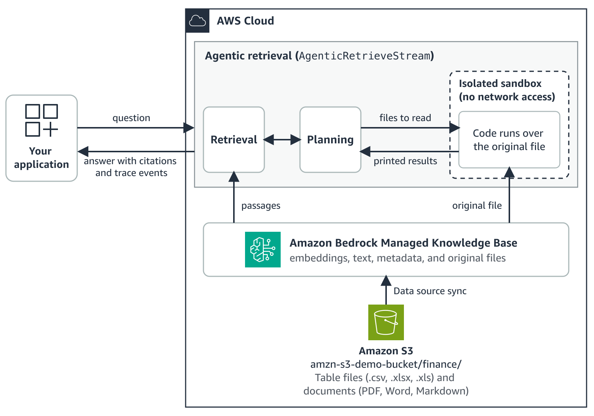

# Tabular search in Amazon Bedrock Managed Knowledge Base

This sample shows how tabular search in Amazon Bedrock Managed Knowledge Base answers questions that need both table data and facts from documents. You deploy a knowledge base of fictitious AnyCompany Retail finance files with the AWS Cloud Development Kit (AWS CDK), and send questions with the `AgenticRetrieveStream` API from Python. Then you read the trace to see which file the code read.

## How tabular search works

Tabular search is part of [agentic retrieval](https://docs.aws.amazon.com/bedrock/latest/userguide/kb-test-agentic-retrieve.html) and runs automatically when a question needs table data, so there's no request field to set. When a question needs data from CSV, XLSX, or XLS files, the request moves through these stages:

1. **Retrieve.** Passages come back, including passages from a table file.
2. **Plan.** The agent uses the question and the table structure to decide whether to run code over one or more retrieved tables.
3. **Stage.** Tabular search copies the original file into an isolated sandbox with no network access.
4. **Compute.** Model-written code runs over the whole table or sheet.
5. **Return.** The agent gets back only what the code prints, such as totals or matching rows.
6. **Answer.** The agent answers from the results and the passages, with citations.



## What gets deployed

`cdk deploy` creates one AWS CloudFormation stack, `tabular-search-finance`, with these resources:

| Resource | Details |
| --- | --- |
| Amazon S3 bucket | All four S3 Block Public Access settings on, ACLs turned off, SSE-S3 encryption with a bucket key, and a bucket policy that requires TLS. Holds the files in `data/finance/` under the `finance/` prefix. |
| IAM role for the knowledge base | The trust policy in `iam/knowledge-base-trust-policy.json`, which trusts only `bedrock.amazonaws.com`, only for knowledge bases in your account. The inline policy in `iam/knowledge-base-s3-read-policy.json`, which allows only `s3:ListBucket` on the bucket and `s3:GetObject` on its objects. The stack deploys these two files as written. |
| Managed knowledge base | `finance-kb`, of type `MANAGED`, with the managed embedding model |
| Data source | `finance-s3`, of type `MANAGED_KNOWLEDGE_BASE_CONNECTOR`. Reads only the `finance/` prefix, ingests files up to 200 MB, and uses `SMART_PARSING`. |
| Ingestion job | Started by the deploy, and again by any deploy that changes the files or the size filter |
| AWS Lambda functions and log groups | AWS CDK adds these to upload the files, start the ingestion job, and empty the bucket when you delete the stack. They run only during `cdk deploy` and `cdk destroy`. |

## Repository structure

```
.
├── infra/                       AWS CDK app (TypeScript)
│   ├── bin/app.ts               Context values and cdk-nag checks
│   ├── lib/tabular-search-stack.ts
│   ├── lib/nag-suppressions.ts  Each accepted cdk-nag finding, with its reason
│   └── test/
├── 01_check_file_types.py       Waits for the sync and checks each file's type
├── 02_ask.py                    Asks a question and prints the trace, the answer, and the cited files
├── 03_conversation.py           Asks a two-turn conversation
├── common.py                    Code that the scripts share
├── tests/                       Offline tests for the scripts
├── questions.json               Sample questions and their expected answers
├── iam/                         The knowledge base role's policies, and the policy for the identity that asks questions
├── data/finance/                The sample files
└── docs/images/                 The architecture diagram
```

## Sample files

All names, companies, and numbers in these files are fictitious.

| File | Contents |
| --- | --- |
| `anycompany-pnl-fy2026.xlsx` | The final profit and loss (P&L) workbook, with Notes, Actuals, Budget, and Summary sheets. Actuals and Budget have one row per month, cost center, and account. |
| `anycompany-pnl-fy2026-draft.xlsx` | A draft copy with different Q3 numbers. Its Notes sheet says not to use it for reporting. |
| `anycompany-finance-variance-policy.pdf` | Defines controllable spend and approved budget, and sets the thresholds for variance commentary and review. |
| `anycompany-fy2026-q3-close-memo.docx` | Lists the approved and rejected Q3 budget revisions. |
| `anycompany-fy2026-business-review.md` | Explains the main variances. |

## Getting this sample

This sample lives in the [sample-managed-knowledge-base-patterns](https://github.com/aws-samples/sample-managed-knowledge-base-patterns) repository alongside other patterns that share no code with it. To get only this one, have Git fetch only this directory. With `--filter=blob:none`, the file contents of the other patterns are never downloaded.

```bash
# Clone the repository structure without any file contents
git clone --filter=blob:none --sparse \
  https://github.com/aws-samples/sample-managed-knowledge-base-patterns.git
cd sample-managed-knowledge-base-patterns

# Fetch only this sample
git sparse-checkout set tabular-search
cd tabular-search
```

Commands in this README run from the `tabular-search` directory unless a step says to change into `infra/`.

## Prerequisites

- An AWS account in a Region where Amazon Bedrock Managed Knowledge Base and tabular search are available. For the Regions that support managed knowledge bases, see [Supported AWS Regions](https://docs.aws.amazon.com/bedrock/latest/userguide/kb-managed-regions.html). The sample was tested in US East (N. Virginia) (`us-east-1`).
- Node.js 22 or later and npm, for the AWS CDK app.
- [uv](https://docs.astral.sh/uv/), which installs Python and the AWS SDK for Python (Boto3) version 1.43.123 or later. Without uv, use Python 3.10 or later and `pip install "boto3>=1.43.123"`. Version 1.43.123 is the first Boto3 release with the trace field that lists the files the code reads.
- AWS credentials for an identity that can:
  - Deploy and delete AWS CDK stacks, which create the S3 bucket, the IAM role, the knowledge base, and the Lambda functions listed in [What gets deployed](#what-gets-deployed).
  - Run the scripts. `01_check_file_types.py` reads the stack outputs (`cloudformation:DescribeStacks`), lists the bucket (`s3:ListBucket`), and reads and starts ingestion jobs (`bedrock:ListIngestionJobs`, `bedrock:GetIngestionJob`, and `bedrock:StartIngestionJob`).
  - Ask questions. The identity that calls `AgenticRetrieveStream` needs the policy in `iam/caller-policy.json`, from the [agentic retrieval documentation](https://docs.aws.amazon.com/bedrock/latest/userguide/kb-test-agentic-retrieve.html). Replace `<REGION>` and `<ACCOUNT_ID>` before you attach it. It includes `bedrock:GetDocumentContent`, because the agent reads the original table file with the caller's credentials.

## Cost

The stack has no always-on compute. These charges apply:

- **Standing cost, until you delete the stack:** knowledge base storage for the five sample files, and S3 storage for the files and the CDK assets. The sample files total about 126 KB.
- **Ingestion,** each time the data source syncs. The deploy syncs once, and again when the files or the size filter change.
- **Per question:** agentic retrieval, including the managed models that plan, rerank, and answer, and the code that tabular search runs.
- **AWS Lambda and Amazon CloudWatch Logs,** for the functions that run during `cdk deploy` and `cdk destroy`.

For details, see [Amazon Bedrock pricing](https://aws.amazon.com/bedrock/pricing/) and [Amazon S3 pricing](https://aws.amazon.com/s3/pricing/). [Clean up](#clean-up) when you finish.

## Deploy

```bash
export AWS_REGION=<region>
make install          # or: uv sync, and npm ci in infra/
cd infra
npx cdk bootstrap     # once per account and Region
npx cdk deploy
cd ..
```

The scripts and the CDK app use the default AWS credential chain, so you can also set `AWS_PROFILE`.

The stack creates an IAM role and policies, so `cdk deploy` lists those IAM changes and asks `Do you wish to deploy these changes? (y/n)`. Review the changes, then enter `y`.

`cdk deploy` uploads the sample files and starts an ingestion job. The stack prints these outputs, which the scripts read for you:

| Output | Description |
| --- | --- |
| `KnowledgeBaseId` | The knowledge base to ask |
| `DataSourceId` | The data source of the sample files |
| `BucketName` | The bucket that holds the files |
| `DocumentPrefix` | The prefix the data source reads, `finance/` |

## Step 1: Check the file types

```bash
uv run python 01_check_file_types.py
```

The first sync starts during `cdk deploy` and continues after the deploy finishes. The script waits until the sync is `COMPLETE` and prints its statistics. It then sends a `Retrieve` request for each file in the bucket, filtered on `_document_title`, and prints the `_file_type` the knowledge base assigned.

How long the sync takes depends on the files. A file's text can become searchable before the sync finishes. To check the file types without waiting, pass `--skip-sync`.

Tabular search runs code when the file type is `CSV` (for CSV files) or `MS_EXCEL` (for XLSX and XLS files). For the sample files, expect these types:

| File | `_file_type` | Tabular search |
| --- | --- | --- |
| `anycompany-pnl-fy2026.xlsx` | `MS_EXCEL` | yes |
| `anycompany-pnl-fy2026-draft.xlsx` | `MS_EXCEL` | yes |
| `anycompany-finance-variance-policy.pdf` | `PDF` | no, a document |
| `anycompany-fy2026-q3-close-memo.docx` | `MS_WORD` | no, a document |
| `anycompany-fy2026-business-review.md` | `PLAIN_TEXT` | no, a document |

To start a new sync first, pass `--sync`.

## Step 2: Ask a question

```bash
uv run python 02_ask.py overspend
```

`overspend` is a question ID from `questions.json`. To list the IDs, run `uv run python 02_ask.py --list`. To ask your own question, put it in quotes:

```bash
uv run python 02_ask.py "Which department had the highest Q2 travel spend in the final FY2026 P&L workbook?"
```

The script sends the question with `AgenticRetrieveStream` and prints each trace step, the files the code reads, the answer as it streams, and the files the answer cites. The following output is from a test run. Your bucket name, timings, trace steps, and wording will differ, and the answer is shortened here.

```text
Question: In fiscal Q2 of FY2026, which cost center had the largest overspend in controllable spend, as the finance policy defines it? Compare the Actuals and Budget sheets of the FY2026 P&L workbook and give the cost center and the overspend in US dollars.

[   0.3 s] SpeculativeRetrieval IN_PROGRESS
[   1.8 s] SpeculativeRetrieval SUCCEEDED
[   2.9 s] Planning IN_PROGRESS
[   8.3 s] Planning SUCCEEDED
           code will read: s3://amzn-s3-demo-bucket/finance/anycompany-pnl-fy2026.xlsx
[   8.3 s] CodeExecution IN_PROGRESS: Running code over 1 document(s): s3://amzn-s3-demo-bucket/finance/anycompany-pnl-fy2026.xlsx
[  12.1 s] CodeExecution SUCCEEDED: Code execution completed successfully: s3://amzn-s3-demo-bucket/finance/anycompany-pnl-fy2026.xlsx (40.7 KB)
[  13.0 s] Planning IN_PROGRESS
[  13.0 s] Planning SUCCEEDED

Answer:
In fiscal Q2 of FY2026 (May–July 2025), the largest controllable-spend overspend was in **CC-3010 (Platform)**, in the Engineering department.
...
| CC-3010 | Platform | 394,859.90 | 270,300.00 | **124,559.90** |
...
This aligns with the Q2 business review, which attributes the Platform cost center's overspend to contractors brought in to finish the data platform migration ahead of the Product-12 launch, with those contracts ending in July.

Cited files:
  s3://amzn-s3-demo-bucket/finance/anycompany-finance-variance-policy.pdf
  s3://amzn-s3-demo-bucket/finance/anycompany-fy2026-business-review.md

Request ID: <request-id>

Expected for the sample files: CC-3010 (Platform) is over by 124,559.90 USD: actual 394,859.90 against a budget of 270,300.00. Counting every operating expense account instead of only controllable spend gives 133,434.05.
```

The figures come from the code, which read the workbook named on the `code will read` line. The `Planning` event names only the final workbook, because the policy and the business review arrive as retrieved passages. The citations point to those passages, which supplied the definition of controllable spend and the explanation.

The script has these options:

| Option | What it does |
| --- | --- |
| `--list` | Lists the question IDs. |
| `--retrieve-only` | Sends the question to the `Retrieve` API instead, so you can compare plain retrieval. `Retrieve` returns passages only. |
| `--only-file FILE_NAME` | Adds a metadata filter on `_document_title` under `retrievalOverrides`, so retrieval, and therefore the code, uses only that file. |
| `--save-trace PATH` | Writes every stream event to a JSON Lines file, for example `traces/overspend.jsonl`. |
| `--kb-id ID` | Asks an existing knowledge base instead of the one the stack created. |

## Step 3: Continue the conversation

```bash
uv run python 03_conversation.py
```

The script asks two questions. For the second one, it sends the first question, its answer (`"role": "assistant"`), and the new question in `messages`. Tabular search runs in whichever turn needs the table. Here, the first turn asks for a calculation from the Actuals and Budget sheets, so it usually runs code over the workbook, and the second usually answers the policy question from the history. To save each turn's events, pass `--save-traces traces/`.

## Expected answers

The answers depend on files that the sample includes, so you can check them. The wording varies from run to run.

| ID | Question | Expected answer |
| --- | --- | --- |
| `overspend` | Which cost center had the largest overspend in controllable spend in fiscal Q2? | CC-3010 (Platform), over by 124,559.90 USD (actual 394,859.90, budget 270,300.00) |
| `revised-budget` | Did Q3 operating expense stay within the budget as revised in the Q3 close memo? | Yes: actual 9,520,827.60 USD, revised budget 9,570,400.00, under by 49,572.40 |
| `commentary` | Which departments must write variance commentary for fiscal Q3, after the memo's revisions? | Sales (-6.50%), Engineering (+5.79%), and Operations (+6.20%) |
| `conversation`, turn 1 | Calculate Customer Support's actual operating expense and budget for fiscal Q2 from the Actuals and Budget sheets. | Actual 1,034,192.40 USD, budget 920,100.00 (12.40% over) |
| `conversation`, turn 2 | Does that variance need written commentary, and who else reviews it? | Yes, and because the variance exceeds 10%, the CFO, Nikki Wolf, also reviews it |

## Read the trace

Trace events arrive in this order:

1. **Retrieval.** `SpeculativeRetrieval` and `Retrieval` events fetch passages.
2. **Planning.** A `Planning` event with status `SUCCEEDED` includes a `codeExecution` action that names the documents the code will read. The script prints these as `code will read`.
3. **Code.** A `CodeExecution` event with status `IN_PROGRESS`, then one with status `SUCCEEDED` or `FAILED`. The `SUCCEEDED` message names each file the code read and its size. On longer runs, the stream repeats the `IN_PROGRESS` event every 10 seconds, and the script prints `still running`. After a `FAILED` step, the agent can run the code again or answer from the retrieved passages.
4. **Answer.** A second planning round and the answer text come before a final `result` event with the citations.

To keep cell values out of the trace, the trace doesn't include the generated code or its output. It shows which files the code read.

## Use your own files

1. Put your CSV, XLSX, or XLS files and related documents in one folder.
2. Deploy a second stack with a new `name` and the folder's absolute path:

   ```bash
   cd infra
   npx cdk deploy -c name=sales -c dataDir=/path/to/my-files
   cd ..
   uv run python 01_check_file_types.py --stack-name tabular-search-sales
   ```

   The stack is named `tabular-search-<name>`, and creates `<name>-kb` and `<name>-s3`. If a table is larger than 200 MB, also pass `-c maxFileSizeMb=<MB>` with a value above your largest file.

3. Ask questions that pair a rule in one of your documents with a calculation over a table, and name both:

   ```bash
   uv run python 02_ask.py --stack-name tabular-search-sales "Using the discount rules in the pricing policy, how many orders in orders.csv got a discount above the limit?"
   ```

These practices help retrieval find the right table:

- **Name the file when there's more than one version,** for example a draft and a final copy.
- **Ask for the calculation when you want one.** If a summary sheet holds a figure, the agent can answer from it directly. Say "Calculate ... from the Actuals and Budget sheets" to compute from detail rows.
- **Keep tables in CSV, XLSX, or XLS files.** Export tables from PDF or Word documents first.
- **Set the size filter above your largest table,** with `-c maxFileSizeMb=<MB>`, so the data source ingests every table.

## Configuration

Pass these context values to `cdk deploy` with `-c key=value`, or edit `infra/cdk.json`.

| Key | Default | Description |
| --- | --- | --- |
| `name` | `finance` | Names the stack `tabular-search-<name>`, the knowledge base `<name>-kb`, and the data source `<name>-s3`. Use 2 to 32 lowercase letters, numbers, and single hyphens. |
| `dataDir` | `../data/finance` | The folder to upload. A relative path is relative to `infra/`. |
| `maxFileSizeMb` | `200` | The largest file the data source ingests, in MB. Set it above your largest table. |

The scripts take `--stack-name` (default `tabular-search-finance`) and `--region` to find the stack.

## Troubleshooting

| Symptom | What to check |
| --- | --- |
| `Stack tabular-search-finance isn't deployed` | Deploy first, or pass the `--region` or `--stack-name` you deployed with. |
| `No code ran for this question` | Run `01_check_file_types.py --skip-sync` and confirm the table is `CSV` or `MS_EXCEL`. Then ask for the calculation and name the file. Also confirm that tabular search is available in your Region. |
| `CodeExecution` lines print, but no `code will read` lines | Update Boto3 to 1.43.123 or later with `uv sync`, or `pip install "boto3>=1.43.123"`. |
| `Cited files` lists documents but not the workbook | Citations point to the passages the answer used. The `code will read` line shows which workbook the figures came from. |
| The ingestion job skipped a file | Check whether the file is larger than `maxFileSizeMb`. To include it, deploy again with a larger `-c maxFileSizeMb=<MB>`, which also starts a new sync. |
| `AccessDeniedException` from `AgenticRetrieveStream` | Attach `iam/caller-policy.json` to the identity that asks questions. |
| `cdk deploy` reports that the environment isn't bootstrapped | Run `npx cdk bootstrap` in `infra/` once for the account and Region. |

## Development

```bash
make lint    # ruff, mypy --strict, tsc
make test    # pytest (offline), jest (including cdk-nag)
make synth   # cdk synth through cdk.json, without deploying
```

`cdk synth` fails on any cdk-nag AwsSolutions finding that is not acknowledged. The acknowledgements in `infra/lib/nag-suppressions.ts` list what to harden before production use, such as S3 server access logging.

The infrastructure tests also check that the deployed role's trust and S3 read policies match the files in `iam/`. To change the role, change those files.

## Clean up

To avoid ongoing charges, delete the stack:

```bash
cd infra
npx cdk destroy
```

The stack deletes the data source and its indexed content, the knowledge base, the bucket and every object in it, the IAM role, the Lambda functions, and their log groups. If you deployed with `-c name=<name>`, pass the same value to `cdk destroy`.

Use `cdk destroy` rather than the console to delete the resources. That keeps the stack and its resources in step, so later deploys and deletes work as expected.

## Security

This sample is for demonstration. Review the cdk-nag acknowledgements and your organization's requirements before you adapt it.

The data source has document-level access control turned off (`aclEnabled: false`), so any identity that can call `Retrieve` or `AgenticRetrieveStream` on the knowledge base can read every file in it. For per-user access, see the other patterns in this repository, which use document-level access control lists (ACLs). `iam/caller-policy.json` allows access to every knowledge base in the account and Region. In your own applications, scope `Resource` to the knowledge bases the identity needs.

Read [SECURITY.md](SECURITY.md) before you change the knowledge base role or the caller policy. It lists the security properties the sample depends on, and how to report a vulnerability.

## Contributing

See [CONTRIBUTING.md](../CONTRIBUTING.md).

## License

MIT-0. See [LICENSE](../LICENSE).
